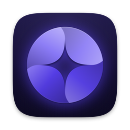
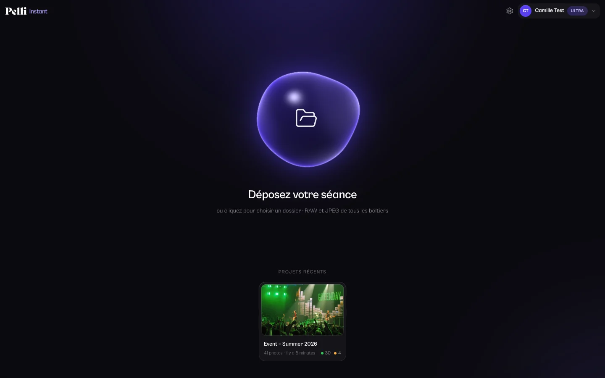
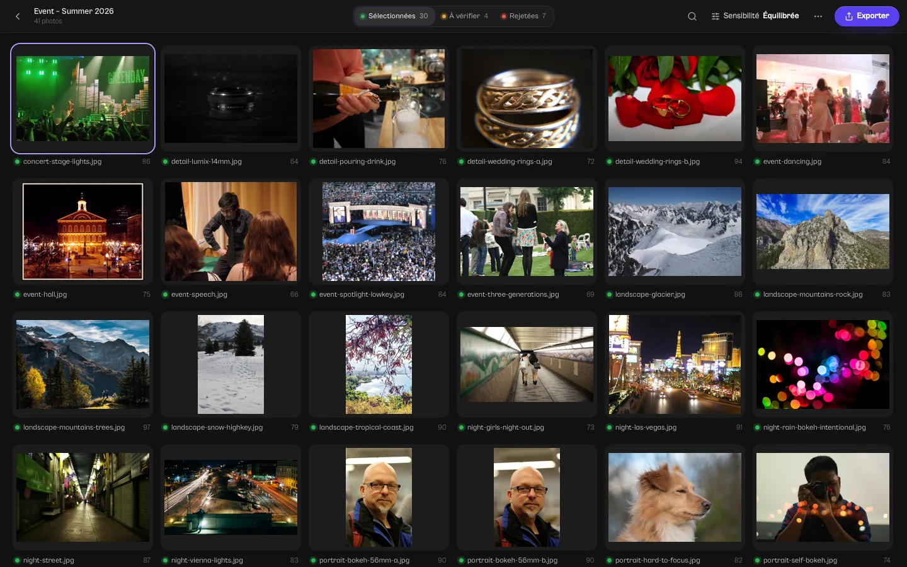
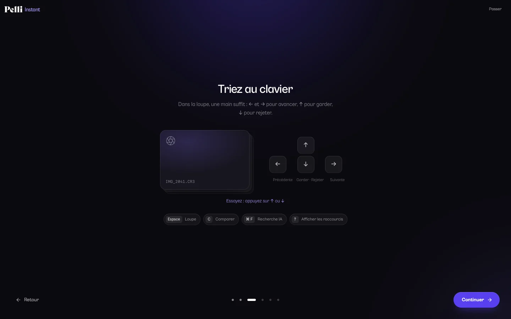

<div align="center">

<a href="https://pelli.io"></a>

# Pelli Instant

**Le tri photo par IA, open source, pour Mac et Windows.**<br />
Déposez une séance : les photos floues, les yeux fermés et les doublons sont écartés, les meilleures sont gardées. Sur votre ordinateur.

[](https://github.com/Synapsr/Pelli-Instant/releases)
[](https://github.com/Synapsr/Pelli-Instant/actions/workflows/ci.yml)
[](LICENSE)
[](#installer)
[](https://tauri.app)
[](docs/contributing.md)

[**Site web**](https://pelli.io) · [**Télécharger**](https://github.com/Synapsr/Pelli-Instant/releases) · [**Documentation**](docs/) · [**Contribuer**](docs/contributing.md) · [English](README.md)

</div>

<p align="center">
  
</p>

## Pelli Instant, c'est quoi ?

Pelli Instant trie vos séances photo à votre place. Déposez un dossier de RAW ou de JPEG : il repère les photos floues ou bougées, les yeux fermés, les erreurs d'exposition et les doublons, garde la meilleure image de chaque rafale, et répartit la séance en **Sélectionnées**, **À vérifier** et **Rejetées**. Vous repassez derrière lui au clavier, vous corrigez ce qui ne vous convient pas, puis vous exportez : étoiles et étiquettes de couleur pour Lightroom, Capture One ou Bridge, copie de la sélection, ou rejets rangés dans un sous-dossier.

Tout se passe sur votre ordinateur. Le tri n'envoie jamais vos photos nulle part : les modèles d'IA tournent en local avec ONNX Runtime, sur le processeur des Mac Apple Silicon (le plus rapide pour eux) et accélérés par DirectML sous Windows. Aucune télémétrie.

Pelli Instant est développé par l'équipe de [Pelli](https://pelli.io), la plateforme où les photographes livrent et vendent leur travail. L'app est gratuite et open source. Les versions officielles demandent un compte Pelli, gratuit.

Vous cherchez une alternative open source à Aftershoot, Narrative Select ou FilterPixel, qui garde vos photos sur votre ordinateur ? C'est exactement ce que fait Pelli Instant.

## Comment ça marche

1. **Déposez une séance.** Glissez un dossier sur la fenêtre ou choisissez-le, avec ou sans ses sous-dossiers. Un RAW et son JPEG jumeau comptent pour une seule photo.
2. **Laissez trier.** Avant la première analyse, Pelli Instant montre ce qu'il va vérifier : désactivez ce que vous ne voulez pas, ou lancez directement. Il lit l'aperçu que l'appareil a glissé dans chaque RAW (il ne développe jamais le RAW), mesure la netteté, le bougé et l'exposition, trouve les visages et les yeux fermés, et regroupe les rafales. La grille se remplit au fil de l'analyse.
3. **Vérifiez.** Sélectionnées, À vérifier, Rejetées : chaque rejet dit pourquoi (Floue, Bougé, Yeux fermés, Doublon…). Une touche suffit pour changer d'avis, et vos choix passent toujours avant ceux de l'IA.
4. **Exportez.** Notes pour Lightroom, copie de la sélection ou rejets mis de côté. Rien n'est jamais supprimé.

<p align="center">
  
  <br />
  <sub>Photos de photographes Flickr sous licence CC BY 2.0 et CC0 : <a href="docs/images/CREDITS.md">crédits</a>.</sub>
</p>

## Fonctionnalités

| Fonctionnalité | Ce qu'elle fait |
| --- | --- |
| **Une netteté fiable** | Mesure la largeur des contours, pas leur contraste : faible profondeur de champ, ISO élevés et lumière douce ne passent pas pour du flou. Quand il y a un visage, c'est sa netteté qui compte : un visage net sur un bokeh crémeux est net, un fond net derrière un visage flou est signalé *Mise au point sujet*. |
| **Le bougé** | Distingue le bougé de l'appareil ou du sujet d'une texture orientée comme des cheveux, une fourrure ou un tissu. |
| **Les yeux fermés** | Lit les yeux des visages de la photo, et distingue un clignement d'un sourire qui plisse les yeux. En Équilibrée et en Souple, des yeux fermés envoient la photo à vérifier, jamais seuls aux rejets : un baiser ou une prière les ferment exprès. |
| **L'exposition en diaphs** | Estime de combien de diaphs une photo est décalée. Les low key et high key voulues restent bonnes ; à 2 diaphs, la photo part en général à vérifier, puisqu'un RAW se rattrape. |
| **Rafales et doublons** | Regroupe les images semblables prises à quelques secondes d'écart par le même boîtier, et garde la meilleure, ou les meilleures. Les copies exactes sont retrouvées quelle que soit leur date. |
| **Trois sévérités** | Stricte, Équilibrée ou Souple. Changer de sévérité retrie la séance instantanément, sans tout réanalyser. |
| **Vos critères** | Avant la première analyse d'une séance, activez ou désactivez chaque vérification : flou, bougé, mise au point sur le sujet, yeux fermés, sous- et surexposition, images similaires, doublons exacts. *Respecter le flou artistique* est là pour le bokeh et le flou voulu. Chaque séance garde ses propres critères ; ceux par défaut sont dans *Réglages → Analyse*. |
| **Précision Standard ou Maximale** | *Standard* est livrée avec l'app et rapide. *Maximale* est un téléchargement facultatif de modèles plus grands (environ 777 Mo), depuis *Réglages → Analyse* : des choix plus fins sur les photos de groupe, les rafales et les sujets sans visage, pour une analyse plus lente. Tant qu'elle n'est pas installée, les analyses se font en Standard. |
| **Le tri au clavier** | Grille, loupe avec zoom à 100 %, comparaison côte à côte d'une rafale. Toutes les photos ou une décision à la fois, filtre par raison (Floue, Yeux fermés…). Dans la loupe, ↑ garde et ↓ rejette, ⌥← / ⌥→ parcourent une rafale ; les touches de Lightroom P, X et U marchent partout. |
| **La recherche IA** | Tapez « mariée bouquet », « première danse » ou « robe bleue » et les bonnes photos remontent en tête. |
| **Des notes pour Lightroom** | Écrit étoiles et étiquettes de couleur dans un fichier `.xmp` à côté de chaque RAW, pour Lightroom, Capture One, Bridge ou darktable. Vous choisissez à l'export les étoiles et la couleur de chaque décision (par défaut : Sélectionnées ★★★ vert, À vérifier jaune, Rejetées en rejet). Les étoiles données dans le boîtier comptent comme les vôtres, un `.xmp` existant garde tous ses réglages, et les étoiles et étiquettes d'un autre logiciel restent, sauf si vous les changez dans Pelli Instant. |
| **La copie de la sélection** | RAW, JPEG ou les deux, dans le dossier de votre choix, sous-dossiers compris. Pelli Instant vous dit combien de place prendra la copie. Chaque fichier est copié en entier ou pas du tout, et un nouvel export ne copie pas deux fois la même photo. |
| **Les rejets rangés** | Déplace les rejets dans un sous-dossier `_Rejets Pelli`, à côté des originaux : un RAW, son JPEG et son `.xmp` partent ensemble. Rien n'est supprimé. |
| **La priorité à vos autres logiciels** | Un interrupteur dans *Réglages → Général* fait tourner l'analyse en arrière-plan, sur moins de cœurs et en basse priorité : Lightroom et votre navigateur restent fluides, le tri prend 3 à 5 fois plus de temps. Désactivé par défaut, pour le tri le plus rapide. |
| **Ça avance sans vous** | Une analyse, un export ou le téléchargement de la précision Maximale empêchent l'ordinateur de se mettre en veille et, sur Mac, gardent toute leur vitesse fenêtre masquée. L'écran peut toujours s'éteindre. |
| **La plupart des appareils** | Canon CR2 et CR3, Nikon NEF, Sony ARW, Fujifilm RAF, DNG, Olympus et OM System ORF, Panasonic RW2, Pentax PEF, Samsung SRW, ainsi que JPEG, PNG et TIFF. |
| **Reprendre là où vous en étiez** | Vos projets restent sur l'écran d'accueil. Rouvrir un dossier n'analyse que les photos nouvelles ou modifiées. |
| **Un démarrage guidé** | Une courte présentation au premier lancement, avec une voix que vous pouvez couper : comment il juge une photo, les raccourcis, la recherche, les exports, la précision et ce que comprend votre formule Pelli. À revoir depuis *Réglages → À propos*. |
| **Pensé pour juger des photos** | Une interface sombre et neutre, comme Lightroom, pour juger les couleurs sur un fond neutre. En 9 langues. |

### Clavier

| Touche | Action |
| --- | --- |
| <kbd>←</kbd> <kbd>→</kbd> | Photo précédente / suivante |
| <kbd>⌥</kbd> <kbd>←</kbd> <kbd>→</kbd> | Photo précédente / suivante de la rafale |
| <kbd>↑</kbd> / <kbd>↓</kbd> (loupe) | Garder / rejeter |
| <kbd>P</kbd> / <kbd>X</kbd> / <kbd>U</kbd> | Garder / rejeter / retirer le marquage, partout |
| <kbd>1</kbd>–<kbd>5</kbd> | Étoiles |
| <kbd>6</kbd>–<kbd>9</kbd> | Étiquette rouge, jaune, verte, bleue |
| <kbd>Espace</kbd> | Loupe |
| <kbd>C</kbd> | Comparer |
| <kbd>Z</kbd> | Zoom 100 % |
| <kbd>⌘</kbd> <kbd>F</kbd> | Recherche IA |
| <kbd>⌘</kbd> <kbd>E</kbd> | Exporter |
| <kbd>?</kbd> | Tous les raccourcis |

Sous Windows, <kbd>Ctrl</kbd> remplace <kbd>⌘</kbd>. Sur un clavier AZERTY, les chiffres se tapent sans <kbd>Maj</kbd>.

<p align="center">
  
</p>

## Forfaits

Pelli Instant est gratuit. Les versions officielles vous demandent de vous connecter avec un compte Pelli, [gratuit à créer](https://app.pelli.io/register) : c'est la seule condition. Le nombre de photos que vous pouvez trier chaque mois dépend de votre forfait Pelli.

| Forfait Pelli | Photos triées par mois |
| --- | --- |
| Gratuit | 200 |
| Lite | 1 000 |
| Pro | Illimité |
| Ultra | Illimité |
| Essai gratuit | Illimité |

- Un RAW et son JPEG jumeau comptent pour une seule photo.
- Retrier ne compte pas : changer de sévérité ou de précision, rouvrir un projet ou réanalyser un dossier ne compte que les photos jamais vues.
- Le compteur repart à zéro le premier jour de chaque mois (heure UTC).

Les prix et le contenu de chaque forfait viennent de Pelli, dans l'app comme sur [pelli.io](https://pelli.io). Les forfaits Pelli couvrent aussi tout ce que Pelli fait sur le web : galeries clients, vente en ligne, devis et factures, prise de rendez-vous.

> [!NOTE]
> **Vous le compilez vous-même ?** Pelli Instant est sous licence MIT, et vous pouvez désactiver le compte et le quota à la compilation : `PELLI_INSTANT_NO_ACCOUNT=1 pnpm tauri dev`, ou la même variable devant `pnpm tauri build` (voir [Building an installer yourself](docs/contributing.md#building-an-installer-yourself), en anglais). Les versions officielles, signées et avec le compte, sont ce qui finance le projet chez Pelli.

## Installer

### Télécharger

| Système | Dernière version |
| --- | --- |
| macOS 12 ou plus récent, Apple Silicon (M1 ou plus récent) | [PelliInstant-macos-arm64.dmg](https://github.com/Synapsr/Pelli-Instant/releases/latest/download/PelliInstant-macos-arm64.dmg)|
| Windows 10 et 11 (x64) | [PelliInstant-windows-x64-setup.exe](https://github.com/Synapsr/Pelli-Instant/releases/latest/download/PelliInstant-windows-x64-setup.exe) |

Les modèles Standard sont livrés dans l'installeur : Pelli Instant fonctionne dès qu'il est installé ; ceux de la précision Maximale se téléchargent depuis l'app, seulement si vous la choisissez. Chaque téléchargement est accompagné de son empreinte SHA-256 (`.sha256`), et chaque version produite par le [workflow de publication](.github/workflows/release.yml) fournit un fichier `SHA256SUMS` et une [attestation de build](https://docs.github.com/actions/security-for-github-actions/using-artifact-attestations) vérifiable avec `gh attestation verify <fichier> --repo Synapsr/Pelli-Instant`.

<details>
<summary><b>Mac Intel</b></summary>

Il n'y a pas de version pour les Mac Intel : ONNX Runtime, qui fait tourner les modèles d'IA, ne fournit pas de bibliothèque précompilée pour eux. On peut compiler ONNX Runtime soi-même ; voir [`crates/cull-ml/README.md`](crates/cull-ml/README.md#packaging-onnx-runtime-tauri).

</details>

<details>
<summary><b>Avertissement Windows SmartScreen</b></summary>

L'installeur Windows n'est pas encore signé par un certificat de signature de code : SmartScreen peut signaler un éditeur inconnu. Cliquez sur **Informations complémentaires → Exécuter quand même**. Vous pouvez d'abord vérifier l'installeur avec son `.sha256`. Il s'installe pour votre seul compte utilisateur, sans droits d'administrateur. Ses mises à jour sont signées avec la clé de mise à jour de Pelli Instant, que l'app vérifie avant de les installer.

</details>

<details>
<summary><b>Linux</b></summary>

Il n'y a pas de version Linux. Le moteur compile et ses tests passent sous Linux dans la CI, et `pnpm tauri dev` peut démarrer, mais l'app n'y est ni empaquetée ni testée. Sous Linux, le jeton de connexion serait rangé dans la base locale de l'app plutôt que dans un trousseau système.

</details>

<details>
<summary><b>Accès aux dossiers sur macOS</b></summary>

Si macOS refuse l'accès à un dossier (Bureau, Documents, disque externe), autorisez Pelli Instant dans **Réglages Système → Confidentialité et sécurité → Fichiers et dossiers**, puis rouvrez le dossier.

</details>

### Mises à jour

Pelli Instant se met à jour tout seul. Quelques secondes après le lancement, puis toutes les six heures, il consulte la [dernière version publiée](https://github.com/Synapsr/Pelli-Instant/releases/latest) ; quand il y en a une plus récente, la fenêtre la propose. Un clic suffit pour l'installer : la mise à jour est téléchargée, sa signature est vérifiée avec la clé propre à Pelli Instant, et l'app redémarre sur la nouvelle version dès qu'aucune analyse, aucun export ni aucun téléchargement n'est en cours. *Réglages → À propos* permet de vérifier à la main. Les préversions ne sont jamais proposées.

### Compiler depuis les sources

Nécessite [rustup](https://rustup.rs) (il installe la version de Rust fixée dans `rust-toolchain.toml`), [Node.js](https://nodejs.org) 22 et [pnpm](https://pnpm.io) 10, sur un Mac Apple Silicon ou un PC Windows x64.

```sh
git clone https://github.com/Synapsr/Pelli-Instant.git
cd Pelli-Instant
pnpm install
pnpm models         # télécharge une fois les modèles Standard (environ 223 Mo, empreintes SHA-256 vérifiées)
pnpm tauri dev      # lance l'app en développement
```

`PELLI_INSTANT_NO_ACCOUNT=1 pnpm tauri dev` la lance sans compte Pelli et sans quota. Pour travailler sur l'interface seule, lancez `pnpm dev` et ouvrez <http://localhost:1420> : un moteur simulé dans le navigateur, sans compiler le Rust. Produire un installeur avec les modèles, et tout le reste : [docs/contributing.md](docs/contributing.md).

## Confidentialité

- **Vos photos sont triées sur votre ordinateur.** Pelli Instant les lit là où elles sont ; le tri ne les envoie jamais nulle part. Ses mesures, ses décisions et vos marquages restent dans une base locale, ses aperçus dans un dossier de cache, tous deux dans votre compte utilisateur ([où exactement](docs/architecture.md#where-data-lives)).
- **Vos dossiers restent intacts jusqu'à l'export.** L'export écrit des fichiers `.xmp` à côté de vos RAW, copie la sélection où vous le décidez, ou déplace les rejets dans `_Rejets Pelli`. Vos fichiers photo ne sont jamais modifiés ni supprimés.
- **Ce que reçoit Pelli.** Avec un compte, l'app ne parle à Pelli (`app.pelli.io`) que pour trois choses. Vous connecter, dans votre navigateur : Pelli reçoit le nom de votre ordinateur, affiché sur la page d'autorisation ; le jeton est ensuite rangé dans le Trousseau macOS ou le Gestionnaire d'identification Windows. Lire votre forfait et les forfaits actuels de Pelli. Compter les photos que vous triez : avant une analyse, le nombre de photos triées pour la première fois ; après, le nombre de celles qu'elle n'a pas pu trier, rendues. Chaque requête indique aussi la version de l'app, le système (macOS ou Windows) et la langue de l'interface. Pour le compte et le quota, Pelli ne reçoit jamais vos photos, ni leurs noms de fichier, ni leur contenu.
- **Ce que l'app télécharge.** Les modèles de la précision Maximale, seulement si vous la choisissez : depuis Hugging Face (`huggingface.co`) et l'espace de stockage de Pelli (`pelli.s3.fr-par.scw.cloud`), chaque fichier étant vérifié par son empreinte SHA-256. Les mises à jour : l'app lit le fichier `latest.json` de la dernière version publiée sur GitHub, et ne télécharge une mise à jour que lorsque vous l'installez.
- **Les modèles d'IA** sont des fichiers figés, à des versions fixées, et leur empreinte SHA-256 est vérifiée au chargement. Depuis les sources, `pnpm models` les télécharge une fois depuis Hugging Face et les autres sources listées dans [`models/manifest.json`](models/manifest.json).
- **Ni statistiques, ni télémétrie, ni rapport de plantage.** La télémétrie propre à ONNX Runtime est désactivée.
- **Sans compte** (versions compilées avec `PELLI_INSTANT_NO_ACCOUNT=1`), Pelli Instant ne parle jamais à `app.pelli.io`. Les modèles de la précision Maximale, si vous les téléchargez, viennent quand même en partie de l'espace de stockage de Pelli.
- **Se déconnecter** efface le jeton de votre ordinateur ; vos projets restent. **Retirer un projet** de l'écran d'accueil efface ses aperçus et son analyse, jamais vos photos. **Supprimer la précision Maximale** (*Réglages → Analyse*) libère ses 777 Mo.

## Langues

**Interface :** anglais, français, espagnol, allemand, italien, portugais, néerlandais, polonais et suédois, avec la présentation de bienvenue racontée dans chacune. [Ajoutez la vôtre](docs/contributing.md#conventions).

**Recherche IA :** le modèle comprend l'anglais. Un glossaire intégré traduit le vocabulaire courant du mariage, de l'événementiel et du portrait, les couleurs, les vêtements et les lieux depuis le français, l'espagnol, l'allemand et l'italien ; les autres mots passent tels quels.

## Questions fréquentes

<details>
<summary><b>Pelli Instant est-il gratuit ?</b></summary>

Oui. L'app est libre et gratuite, sous licence MIT. Les versions officielles demandent un compte Pelli, gratuit, et trient 200 photos par mois avec le forfait Gratuit, 1 000 avec Lite, et autant que vous voulez avec Pro, Ultra ou pendant l'essai gratuit. Si vous la compilez vous-même, vous pouvez désactiver le compte.

</details>

<details>
<summary><b>Pourquoi un compte Pelli pour les versions officielles ?</b></summary>

Parce que c'est ainsi que Pelli finance le travail sur Pelli Instant : le quota mensuel est lié aux forfaits Pelli. Le compte ne sert qu'à vous connecter et à compter les photos. Le code reste ouvert, et chacun peut le compiler sans compte.

</details>

<details>
<summary><b>Précision Standard ou Maximale ?</b></summary>

La précision Standard est livrée avec l'app, rapide, et convient à la plupart des séances. La Maximale ajoute des modèles plus grands, environ 777 Mo à télécharger une fois : un second détecteur de visages pour les photos de groupe, un modèle qui distingue plus nettement les rafales et les quasi-doublons des scènes différentes, un modèle CLIP plus grand pour la recherche et la note esthétique, et le contour des personnes et des animaux, pour qu'un sujet sans visage visible (de dos, en contre-jour) soit jugé sur sa propre netteté et sa propre exposition. L'analyse est plus lente et demande plus de mémoire.

Choisissez-la dans *Réglages → Analyse → Précision* (ou pendant la présentation) : le téléchargement démarre en arrière-plan, reprend là où il s'était arrêté si vous le mettez en pause ou quittez l'app, et chaque fichier est vérifié avant usage. En attendant, les analyses se font en Standard. Une séance déjà triée peut être réanalysée en Maximale ; les photos retriées ne comptent jamais dans votre quota.

</details>

<details>
<summary><b>Est-ce que ça marche hors ligne ?</b></summary>

L'analyse se fait entièrement sur votre ordinateur, sans internet. La connexion à votre compte demande un réseau. Avec Pro, Ultra ou un essai gratuit, vous pouvez trier hors ligne. Avec les forfaits Gratuit et Lite, Pelli Instant a besoin du réseau pour compter les nouvelles photos avant de les trier ; vérifier et exporter une séance déjà triée marche hors ligne. Télécharger la précision Maximale et les mises à jour demande aussi un réseau.

</details>

<details>
<summary><b>Est-ce que ça modifie mes RAW ?</b></summary>

Non. Les étoiles et les étiquettes de couleur vont dans un fichier `.xmp` à côté de chaque RAW (`IMG_0001.xmp`, ou `IMG_0001.CR3.xmp` quand celui-ci existe déjà), et un fichier existant garde tous ses autres réglages : développement, mots-clés, historique. Les étoiles et étiquettes que vous avez mises dans Lightroom ou Capture One restent aussi, sauf si vous les changez dans Pelli Instant : les notes tirées des décisions de l'IA ne remplacent que celles que Pelli Instant a lui-même écrites. Les étoiles données dans le boîtier deviennent vos étoiles dans Pelli Instant (sauf si le RAW a déjà un `.xmp`), et l'export les garde.

Dans Lightroom Classic, sélectionnez les photos, puis **Métadonnées → Lire les métadonnées à partir des fichiers**. Lightroom n'a pas de champ XMP pour ses drapeaux Retenue et Rejetée : une photo rejetée sans étoiles reçoit donc −1 étoile, que Lightroom et Bridge affichent comme *Rejetée*. Une séance en JPEG seul n'a pas de fichier `.xmp`, puisque Lightroom lit les notes d'un JPEG dans le fichier lui-même.

</details>

<details>
<summary><b>Que deviennent mes fichiers quand je copie la sélection ou range les rejets ?</b></summary>

Les copies passent par un fichier temporaire caché, renommé une fois complet : un disque plein ou un disque débranché ne laisse jamais une photo à moitié copiée. Un fichier déjà copié par un export précédent reste tel quel, et quand un nom est pris par un autre fichier, la photo reçoit un seul suffixe pour tous ses fichiers (`IMG_0001-1.CR3`, `IMG_0001-1.JPG`, `IMG_0001-1.xmp`).

Les rejets partent avec leur JPEG jumeau et leur fichier `.xmp`, tous ensemble ou pas du tout : si un fichier ne peut pas être déplacé, les autres reviennent. D'un disque à l'autre, un fichier est copié et vérifié avant que l'original ne soit retiré.

Les dossiers que remplit un export (le dossier des rejets, un dossier de copie neuf ou vide) reçoivent un petit fichier caché, `.pelli-instant-export`, pour qu'une copie faite à l'intérieur de la séance ne soit jamais réanalysée comme de nouvelles photos. Supprimez ce fichier pour les analyser.

</details>

<details>
<summary><b>Quels appareils sont pris en charge ?</b></summary>

Pelli Instant lit l'aperçu JPEG que l'appareil glisse dans chaque RAW : Canon CR2 et CR3, Nikon NEF et NRW, Sony ARW, SR2 et SRF, Fujifilm RAF, DNG, Olympus et OM System ORF, Panasonic RW2, Pentax PEF, Samsung SRW et les autres RAW à base de TIFF, ainsi que les fichiers JPEG, PNG et TIFF. Pas encore pris en charge : le HEIF/HEIC, et les CR3 des Canon récents pris en mode HDR PQ, dont les aperçus sont en HEVC. La liste complète, avec les appareils testés, est dans [`crates/cull-decode/README.md`](crates/cull-decode/README.md).

</details>

<details>
<summary><b>Comment décide-t-il ?</b></summary>

Chaque photo reçoit une note de 0 à 100 qui mêle la netteté, une note esthétique relative à votre séance, les yeux, l'exposition et l'originalité. Un défaut technique net rejette la photo ; un défaut léger l'envoie à vérifier. Les seuils sont relatifs à votre séance autant qu'absolus : une soirée sombre à ISO élevés n'est pas rejetée en bloc. Le détail, écrit pour les photographes (en anglais), est dans [`crates/cull-analysis/README.md`](crates/cull-analysis/README.md#for-photographers).

</details>

<details>
<summary><b>Mes photos servent-elles à entraîner des IA ?</b></summary>

Non. Le tri se fait sur votre ordinateur et n'envoie jamais vos photos : ni Pelli ni personne d'autre ne les reçoit pour entraîner quoi que ce soit. Les modèles sont des fichiers figés ; ils n'apprennent rien de vos séances.

</details>

<details>
<summary><b>Pourquoi pas de version Mac Intel ou Linux ?</b></summary>

Mac Intel : ONNX Runtime ne fournit pas de bibliothèque précompilée pour eux. Linux : l'app n'y est pas encore empaquetée ni testée. Les contributions sont bienvenues sur les deux.

</details>

## Contribuer

Signalements de bugs, traductions et pull requests sont bienvenus. Commencez par [docs/contributing.md](docs/contributing.md) (installation, vérifications, conventions), puis lisez l'[architecture](docs/architecture.md) et la page des [modèles](docs/models.md). Pelli Instant veut rester rapide et digne de confiance : chaque rejet donne sa raison, et avant d'ajouter un réglage, demandez-vous si un meilleur choix par défaut suffirait.

- [Signaler un bug](https://github.com/Synapsr/Pelli-Instant/issues/new?template=bug_report.yml)
- [Proposer une amélioration](https://github.com/Synapsr/Pelli-Instant/issues/new?template=feature_request.yml)
- Une faille de sécurité ? Voir [SECURITY.md](SECURITY.md).
- Pour tout le reste : [contact@pelli.io](mailto:contact@pelli.io)

Si Pelli Instant vous épargne une soirée de tri, une étoile aide d'autres photographes à le trouver.

## Remerciements

Pelli Instant fait tourner [YuNet](https://github.com/opencv/opencv_zoo) (OpenCV Zoo) pour trouver les visages, [MediaPipe Face Mesh et Face Blendshapes](https://github.com/google-ai-edge/mediapipe) (Google ; Face Mesh converti en ONNX par [PINTO0309](https://github.com/PINTO0309/PINTO_model_zoo)) pour lire les yeux et les expressions, [CLIP](https://github.com/openai/CLIP) (OpenAI, ONNX par [Xenova](https://huggingface.co/Xenova)) pour les images semblables et la recherche, et le [prédicteur esthétique de LAION](https://github.com/LAION-AI/aesthetic-predictor). La précision Maximale ajoute CLIP ViT-L/14, [DINOv2](https://github.com/facebookresearch/dinov2) (Meta, ONNX par [onnx-community](https://huggingface.co/onnx-community/dinov2-base-ONNX)), [RF-DETR](https://github.com/roboflow/rf-detr) (Roboflow), [RetinaFace](https://github.com/biubug6/Pytorch_Retinaface) (biubug6) et le [prédicteur esthétique amélioré](https://github.com/christophschuhmann/improved-aesthetic-predictor) (Christoph Schuhmann). Le tout tourne avec [ONNX Runtime](https://onnxruntime.ai) et [`ort`](https://ort.pyke.io). L'app est construite avec [Tauri](https://tauri.app), React et [HeroUI](https://heroui.com). Les photos et la voix de la présentation sont créditées dans [`src/assets/onboarding/CREDITS.md`](src/assets/onboarding/CREDITS.md). Voir [THIRD_PARTY_NOTICES.md](THIRD_PARTY_NOTICES.md).

## Licence

[MIT](LICENSE) © Synapsr
