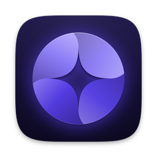
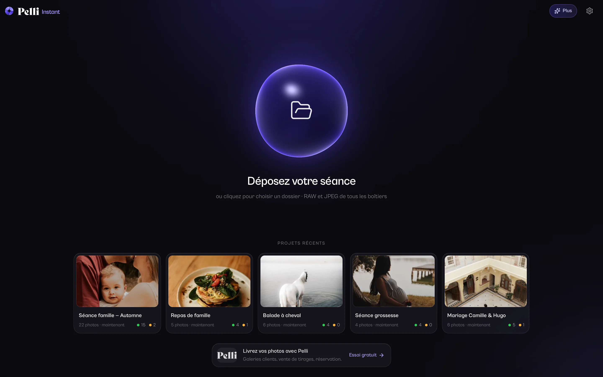
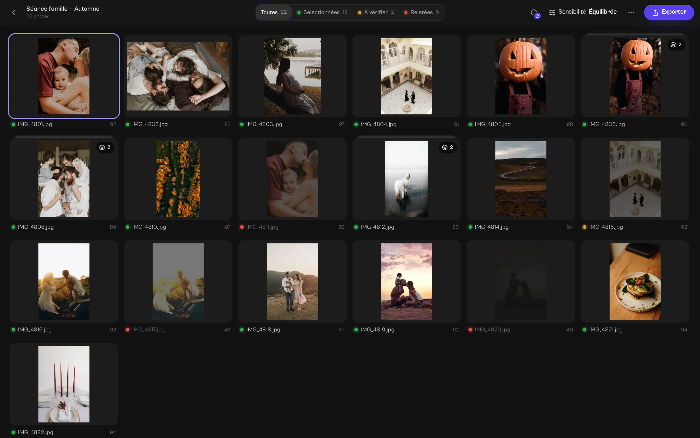
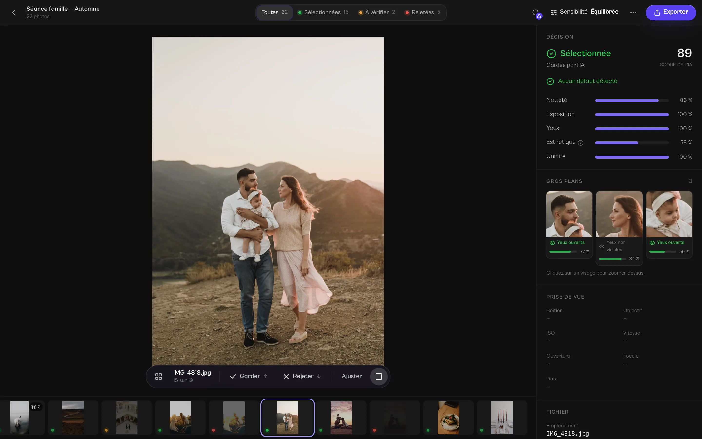
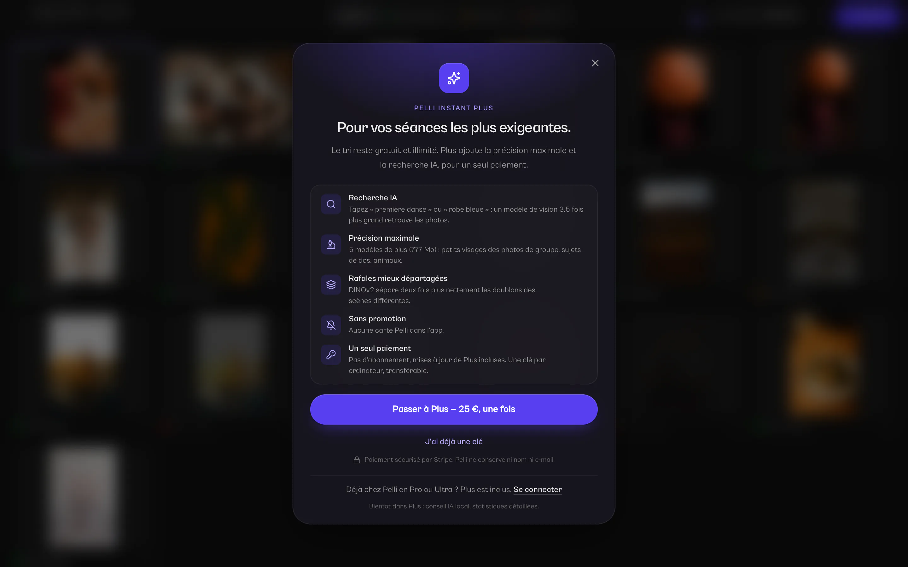
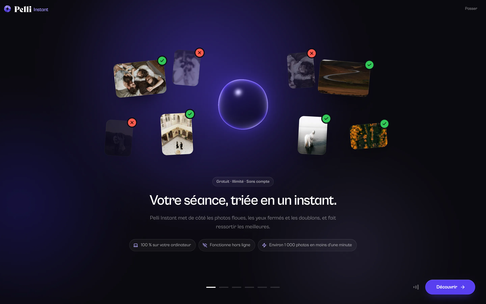

<div align="center">

<a href="https://pelli.io"></a>

# Pelli Instant

**Le tri photo par IA gratuit pour Mac et Windows. Illimité, sans compte, 100 % sur votre ordinateur.**<br />
Déposez une séance : les photos floues, les yeux fermés et les doublons sont écartés, les meilleures sont gardées. Environ 1 000 photos en moins d'une minute.

[](#pelli-instant-plus)
[](#confidentialité-et-télémétrie)
[](#confidentialité-et-télémétrie)
[](https://github.com/Synapsr/Pelli-Instant/releases)
[](https://github.com/Synapsr/Pelli-Instant/actions/workflows/ci.yml)
[](LICENSE)
[](#installer)
[](https://tauri.app)
[](docs/contributing.md)

[**Site web**](https://pelli.io) · [**Télécharger**](https://github.com/Synapsr/Pelli-Instant/releases) · [**Documentation**](docs/) · [**Contribuer**](docs/contributing.md) · [English](README.md)

</div>

<p align="center">
  
</p>

## Pelli Instant, c'est quoi ?

Pelli Instant trie vos séances photo à votre place. Déposez un dossier de RAW ou de JPEG : il repère les photos floues ou bougées, les yeux fermés, les erreurs d'exposition et les doublons, garde la meilleure image de chaque rafale, et répartit la séance en **Sélectionnées**, **À vérifier** et **Rejetées**. Vous repassez derrière lui au clavier, vous corrigez ce qui ne vous convient pas, puis vous exportez : étoiles et étiquettes de couleur pour Lightroom, Capture One ou Bridge, copie de la sélection, ou rejets rangés dans un sous-dossier.

- **Gratuit et illimité.** Triez autant de séances que vous voulez, en précision Standard, sans rien payer et sans limite mensuelle.
- **Sans compte.** Téléchargez, ouvrez, déposez un dossier. Aucune inscription.
- **100 % local.** Les modèles d'IA tournent sur votre ordinateur avec ONNX Runtime, sur le processeur des Mac Apple Silicon (le plus rapide pour eux) et accélérés par DirectML sous Windows. Vos photos ne quittent jamais votre ordinateur, et le tri marche hors ligne.
- **Rapide.** Des dizaines de photos par seconde : un bêta-testeur a trié 854 photos en 10 secondes environ.

Pelli Instant est développé par l'équipe de [Pelli](https://pelli.io), la plateforme où les photographes livrent et vendent leur travail. L'app est open source, sous licence MIT. [Pelli Instant Plus](#pelli-instant-plus), facultatif et payé une seule fois, ajoute la précision maximale et la recherche IA.

Vous cherchez une alternative open source à Aftershoot, Narrative Select ou FilterPixel, qui garde vos photos sur votre ordinateur ? C'est exactement ce que fait Pelli Instant.

## Comment ça marche

1. **Déposez une séance.** Glissez un dossier sur la fenêtre ou choisissez-le, avec ou sans ses sous-dossiers. Un RAW et son JPEG jumeau comptent pour une seule photo.
2. **Laissez trier.** Avant la première analyse, Pelli Instant montre ce qu'il va vérifier : désactivez ce que vous ne voulez pas, ou lancez directement. Il lit l'aperçu que l'appareil a glissé dans chaque RAW (il ne développe jamais le RAW), mesure la netteté, le bougé et l'exposition, trouve les visages et les yeux fermés, et regroupe les rafales. La grille se remplit au fil de l'analyse.
3. **Vérifiez.** Sélectionnées, À vérifier, Rejetées : chaque rejet dit pourquoi (Floue, Bougé, Yeux fermés, Doublon…). Une touche suffit pour changer d'avis, et vos choix passent toujours avant ceux de l'IA.
4. **Exportez.** Notes pour Lightroom, copie de la sélection ou rejets mis de côté. Rien n'est jamais supprimé.

<p align="center">
  
  <br />
  <sub>Photos : Pexels (<a href="docs/images/CREDITS.md">crédits</a>). Les verdicts sont ceux de l'app.</sub>
</p>

## Fonctionnalités

| Fonctionnalité | Ce qu'elle fait |
| --- | --- |
| **Gratuit, illimité, sans compte** | Chaque analyse se fait sur votre ordinateur : pas de quota, pas de connexion, pas besoin d'internet. |
| **Une netteté fiable** | Mesure la largeur des contours, pas leur contraste : faible profondeur de champ, ISO élevés et lumière douce ne passent pas pour du flou. Quand il y a un visage, c'est sa netteté qui compte : un visage net sur un bokeh crémeux est net, un fond net derrière un visage flou est signalé *Mise au point sujet*. |
| **Le bougé** | Distingue le bougé de l'appareil ou du sujet d'une texture orientée comme des cheveux, une fourrure ou un tissu. |
| **Les yeux fermés** | Lit les yeux des visages de la photo, et distingue un clignement d'un sourire qui plisse les yeux. En Équilibrée et en Souple, des yeux fermés envoient la photo à vérifier, jamais seuls aux rejets : un baiser ou une prière les ferment exprès. |
| **L'exposition en diaphs** | Estime de combien de diaphs une photo est décalée. Les low key et high key voulues restent bonnes ; à 2 diaphs, la photo part en général à vérifier, puisqu'un RAW se rattrape. |
| **Rafales et doublons** | Regroupe les images semblables prises à quelques secondes d'écart par le même boîtier, et garde la meilleure, ou les meilleures. Les copies exactes sont retrouvées quelle que soit leur date. |
| **Trois sévérités** | Stricte, Équilibrée ou Souple. Changer de sévérité retrie la séance instantanément, sans tout réanalyser. |
| **Vos critères** | Avant la première analyse d'une séance, activez ou désactivez chaque vérification : flou, bougé, mise au point sur le sujet, yeux fermés, sous- et surexposition, images similaires, doublons exacts. *Respecter le flou artistique* est là pour le bokeh et le flou voulu. Chaque séance garde ses propres critères ; ceux par défaut sont dans *Réglages → Analyse*. |
| **La précision Standard, gratuite** | Les modèles livrés avec l'app : rapides, et déjà très fins. La précision *Maximale*, avec des modèles plus grands, fait partie de [Plus](#pelli-instant-plus). |
| **Le tri au clavier** | Grille, loupe avec zoom à 100 % et plein écran (F), comparaison côte à côte d'une rafale. Toutes les photos ou une décision à la fois, filtre par raison (Floue, Yeux fermés…). Dans la loupe, ↑ garde et ↓ rejette ; ⌥← / ⌥→ parcourent une rafale sans la déplier, et S choisit l'image affichée : elle est gardée, les autres images sélectionnées de la rafale sont rejetées. Dans une rafale, les images suivent le tri de la grille (ordre de prise de vue par date). Les touches de Lightroom P, X et U marchent partout. |
| **La recherche IA** (Plus) | Tapez « mariée bouquet », « première danse » ou « robe bleue » et les bonnes photos remontent en tête. |
| **Des notes pour Lightroom** | Écrit étoiles, étiquettes de couleur et marqueurs Retenue et Rejetée dans un fichier `.xmp` à côté de chaque RAW, pour Lightroom, Capture One, Bridge ou darktable. Vous choisissez à l'export les étoiles et la couleur de chaque décision (par défaut : Sélectionnées ★★★ vert, À vérifier jaune, Rejetées en rejet), et les noms des couleurs sont écrits dans la langue de votre Lightroom. Les photos sélectionnées arrivent marquées *Retenue* et les rejetées *Rejetée* dans Lightroom Classic 13.2 et suivants. Les étoiles données dans le boîtier comptent comme les vôtres, un `.xmp` existant garde tous ses réglages, et les étoiles, étiquettes et marqueurs d'un autre logiciel restent, sauf si vous les changez dans Pelli Instant. |
| **La copie de la sélection** | RAW, JPEG ou les deux, dans le dossier de votre choix, sous-dossiers compris. Pelli Instant vous dit combien de place prendra la copie. Chaque fichier est copié en entier ou pas du tout, et un nouvel export ne copie pas deux fois la même photo. |
| **Les rejets rangés** | Déplace les rejets dans un sous-dossier `_Rejets Pelli`, à côté des originaux : un RAW, son JPEG et son `.xmp` partent ensemble. Rien n'est supprimé. |
| **La priorité à vos autres logiciels** | Un interrupteur dans *Réglages → Général* fait tourner l'analyse en arrière-plan, sur moins de cœurs et en basse priorité : Lightroom et votre navigateur restent fluides, le tri prend 3 à 5 fois plus de temps. Désactivé par défaut, pour le tri le plus rapide. |
| **Ça avance sans vous** | Une analyse, un export ou le téléchargement de la précision Maximale empêchent l'ordinateur de se mettre en veille et, sur Mac, gardent toute leur vitesse fenêtre masquée. L'écran peut toujours s'éteindre. |
| **La plupart des appareils** | Canon CR2 et CR3, Nikon NEF, Sony ARW, Fujifilm RAF, DNG, Olympus et OM System ORF, Panasonic RW2, Pentax PEF, Samsung SRW, ainsi que JPEG, PNG et TIFF. |
| **Reprendre là où vous en étiez** | Vos projets restent sur l'écran d'accueil. Rouvrir un dossier n'analyse que les photos nouvelles ou modifiées. |
| **Un démarrage guidé** | Une courte présentation au premier lancement, avec une voix que vous pouvez couper : comment il juge une photo, les raccourcis, les exports, la précision, et le choix de partager ou non des statistiques anonymes. À revoir depuis *Réglages → À propos*. |
| **Pensé pour juger des photos** | Une interface sombre et neutre, comme Lightroom, pour juger les couleurs sur un fond neutre. En 9 langues. |

### Clavier

| Touche | Action |
| --- | --- |
| <kbd>←</kbd> <kbd>→</kbd> | Photo précédente / suivante |
| <kbd>⌥</kbd> <kbd>←</kbd> <kbd>→</kbd> | Photo précédente / suivante de la rafale, sans la déplier |
| <kbd>↑</kbd> / <kbd>↓</kbd> (loupe) | Garder / rejeter |
| <kbd>P</kbd> / <kbd>X</kbd> / <kbd>U</kbd> | Garder / rejeter / retirer le marquage, partout |
| <kbd>S</kbd> | Choisir cette photo de la rafale : la garder, rejeter les autres sélectionnées |
| <kbd>1</kbd>–<kbd>5</kbd> | Étoiles |
| <kbd>6</kbd>–<kbd>9</kbd> | Étiquette rouge, jaune, verte, bleue |
| <kbd>Espace</kbd> | Loupe |
| <kbd>C</kbd> | Comparer |
| <kbd>Z</kbd> | Zoom 100 % |
| <kbd>F</kbd> | Plein écran, la photo seule (<kbd>Échap</kbd> pour sortir) |
| <kbd>⌘</kbd> <kbd>F</kbd> | Recherche IA (Plus) |
| <kbd>⌘</kbd> <kbd>E</kbd> | Exporter |
| <kbd>?</kbd> | Tous les raccourcis |

Sous Windows, <kbd>Ctrl</kbd> remplace <kbd>⌘</kbd>. Sur un clavier AZERTY, les chiffres se tapent sans <kbd>Maj</kbd>.

<p align="center">
  
</p>

## Pelli Instant Plus

Le tri reste gratuit et illimité. **Plus**, c'est pour vos séances les plus exigeantes : **25 € en Europe, 25 $ ailleurs, payés une seule fois**, pour un ordinateur. Pas d'abonnement, pas de compte, mises à jour de Plus incluses.

| Avec Plus | Ce que ça apporte |
| --- | --- |
| **La précision maximale** | 5 modèles de plus, environ 777 Mo à télécharger une fois : RetinaFace ResNet-50 trouve les petits visages des photos de groupe (un second passage à 1 280 px), DINOv2 regroupe les rafales et les quasi-doublons (il sépare les doublons des scènes différentes environ deux fois plus nettement que le CLIP B/32 de la précision Standard : +0,25 de cosinus contre +0,11), CLIP ViT-L/14 (un modèle de vision environ 3,5 fois plus grand) pour la recherche et la note esthétique, RF-DETR-Seg juge les sujets sans visage exploitable (de dos, les animaux), avec la note esthétique LAION V2. Plus lent, plus fin. |
| **La recherche IA** | Tapez « première danse », « robe bleue » ou « blue dress » : les bonnes photos remontent en tête. |
| **Aucune promotion Pelli** | La version gratuite montre deux petites cartes Pelli, sur l'écran d'accueil et à la fin d'un export. Plus les retire. |

- **Une clé par ordinateur, transférable.** Le paiement se fait avec Stripe dans votre navigateur, et l'app s'active toute seule. Votre clé (`XXXX-XXXX-XXXX-XXXX`) s'affiche dans l'app et sur la page de confirmation : pour passer Plus sur un autre ordinateur, *Libérer cette licence* dans *Réglages → Pelli Instant Plus*, puis saisissez la clé sur l'autre. Réinstaller sur le même ordinateur demande seulement de ressaisir la clé.
- **Discret.** Pelli ne garde ni nom, ni e-mail, ni pays pour Plus : seulement la clé, une empreinte de l'identifiant de votre ordinateur et la référence du paiement. Stripe s'occupe du paiement et envoie le reçu, comme pour tout paiement Pelli. Une fois activé, Plus marche hors ligne.
- **Déjà chez Pelli en Pro ou Ultra ?** Plus est inclus (offres à vie et essais Pro ou Ultra compris) : connectez-vous avec votre compte Pelli dans *Réglages → Pelli Instant Plus*.

<p align="center">
  
</p>

### Bientôt

- **Des conseils d'IA en local**, dans Plus : un modèle facultatif, lui aussi sur votre ordinateur, qui commente chaque photo ou toute une séance.
- **Des statistiques détaillées**, dans Plus : votre taux de photos gardées, les raisons des rejets et plus, sur toutes vos séances.

<p align="center">
  
</p>

## Installer

### Télécharger

| Système | Dernière version |
| --- | --- |
| macOS 12 ou plus récent, Apple Silicon (M1 ou plus récent) | [PelliInstant-macos-arm64.dmg](https://github.com/Synapsr/Pelli-Instant/releases/latest/download/PelliInstant-macos-arm64.dmg)|
| Windows 10 et 11 (x64) | [PelliInstant-windows-x64-setup.exe](https://github.com/Synapsr/Pelli-Instant/releases/latest/download/PelliInstant-windows-x64-setup.exe) |

Les modèles Standard sont livrés dans l'installeur : Pelli Instant fonctionne dès qu'il est installé, hors ligne compris ; ceux de la précision Maximale se téléchargent depuis l'app, avec Plus, seulement si vous la choisissez. Chaque téléchargement est accompagné de son empreinte SHA-256 (`.sha256`), et chaque version produite par le [workflow de publication](.github/workflows/release.yml) fournit un fichier `SHA256SUMS` et une [attestation de build](https://docs.github.com/actions/security-for-github-actions/using-artifact-attestations) vérifiable avec `gh attestation verify <fichier> --repo Synapsr/Pelli-Instant`.

<details>
<summary><b>Mac Intel</b></summary>

Il n'y a pas de version pour les Mac Intel : ONNX Runtime, qui fait tourner les modèles d'IA, ne fournit pas de bibliothèque précompilée pour eux. On peut compiler ONNX Runtime soi-même ; voir [`crates/cull-ml/README.md`](crates/cull-ml/README.md#packaging-onnx-runtime-tauri).

</details>

<details>
<summary><b>Avertissement Windows SmartScreen</b></summary>

L'installeur Windows n'est pas encore signé par un certificat de signature de code : SmartScreen peut signaler un éditeur inconnu. Cliquez sur **Informations complémentaires → Exécuter quand même**. Vous pouvez d'abord vérifier l'installeur avec son `.sha256`. Il s'installe pour votre seul compte utilisateur, sans droits d'administrateur. Ses mises à jour sont signées avec la clé de mise à jour de Pelli Instant, que l'app vérifie avant de les installer.

</details>

<details>
<summary><b>Linux</b></summary>

Il n'y a pas de version Linux. Le moteur compile et ses tests passent sous Linux dans la CI, et `pnpm tauri dev` peut démarrer, mais l'app n'y est ni empaquetée ni testée. Sous Linux, le jeton du compte Pelli facultatif serait rangé dans la base locale de l'app plutôt que dans un trousseau système.

</details>

<details>
<summary><b>Accès aux dossiers sur macOS</b></summary>

Si macOS refuse l'accès à un dossier (Bureau, Documents, disque externe), autorisez Pelli Instant dans **Réglages Système → Confidentialité et sécurité → Fichiers et dossiers**, puis rouvrez le dossier.

</details>

### Mises à jour

Pelli Instant se met à jour tout seul. Quelques secondes après le lancement, puis toutes les six heures, il consulte la [dernière version publiée](https://github.com/Synapsr/Pelli-Instant/releases/latest) ; quand il y en a une plus récente, la fenêtre la propose. Un clic suffit pour l'installer : la mise à jour est téléchargée, sa signature est vérifiée avec la clé propre à Pelli Instant, et l'app redémarre sur la nouvelle version dès qu'aucune analyse, aucun export ni aucun téléchargement n'est en cours. *Réglages → À propos* permet de vérifier à la main. Les préversions ne sont jamais proposées.

### Compiler depuis les sources

Nécessite [rustup](https://rustup.rs) (il installe la version de Rust fixée dans `rust-toolchain.toml`), [Node.js](https://nodejs.org) 22 et [pnpm](https://pnpm.io) 10, sur un Mac Apple Silicon ou un PC Windows x64.

```sh
git clone https://github.com/Synapsr/Pelli-Instant.git
cd Pelli-Instant
pnpm install
pnpm models         # télécharge une fois les modèles Standard (environ 223 Mo, empreintes SHA-256 vérifiées)
pnpm tauri dev      # lance l'app en développement
```

Compilée depuis les sources, elle trie exactement comme l'app officielle : gratuite, illimitée, sans compte. Pour travailler sur l'interface seule, lancez `pnpm dev` et ouvrez <http://localhost:1420> : un moteur simulé dans le navigateur, sans compiler le Rust. Produire un installeur avec les modèles, un faux Pelli pour travailler sur Plus et la télémétrie, et tout le reste : [docs/contributing.md](docs/contributing.md) (en anglais).

## Confidentialité et télémétrie

- **Vos photos sont triées sur votre ordinateur.** Pelli Instant les lit là où elles sont ; le tri ne les envoie jamais nulle part, pas même leurs noms de fichier. Ses mesures, ses décisions et vos marquages restent dans une base locale, ses aperçus dans un dossier de cache, tous deux dans votre compte utilisateur ([où exactement](docs/architecture.md#where-data-lives)).
- **Vos dossiers restent intacts jusqu'à l'export.** L'export écrit des fichiers `.xmp` à côté de vos RAW, copie la sélection où vous le décidez, ou déplace les rejets dans `_Rejets Pelli`. Vos fichiers photo ne sont jamais modifiés ni supprimés.
- **Sans compte, sans connexion.** Rien à créer, rien à quoi se connecter.

### Les statistiques anonymes

Pelli Instant envoie quelques statistiques anonymes à Pelli (`app.pelli.io`), pour savoir combien de personnes l'utilisent et à quelle vitesse il trie. **Elles sont activées par défaut et un interrupteur les coupe :** à la dernière étape de la présentation (avec le détail de ce qui est envoyé), ou plus tard dans *Réglages → Confidentialité*. Le code est dans [`crates/cull-engine/src/telemetry.rs`](crates/cull-engine/src/telemetry.rs).

| Événement | Quand | Ce qu'il dit |
| --- | --- | --- |
| `onboarding_completed` | La présentation est terminée | Rien de plus |
| `app_opened` | Au lancement, au plus une fois par jour | Rien de plus |
| `analysis_completed` | Un tri est terminé | Le nombre de photos (RAW, JPEG), la durée, la précision, combien sont sélectionnées, à vérifier et rejetées, le nombre de rafales |
| `export_completed` | Un export est terminé | Le nombre de photos et les sorties choisies (notes, copie, rejets rangés) |
| `plus_activated` | Plus vient d'être activé | Comment : achat, clé ou compte Pelli |
| `telemetry_disabled` | Vous avez coupé les statistiques | Rien de plus : c'est le dernier message |

Chaque message porte aussi un identifiant d'installation aléatoire (un nombre tiré au hasard, sans lien avec votre ordinateur, une licence ou un compte), la version de l'app, le système (Mac, Windows), le type de processeur (arm64, x64) et la langue de l'app. Jamais une photo, un nom de fichier, un dossier, votre nom ni rien de personnel. Pelli ne garde aucune adresse IP avec eux.

- **Coupées pendant la présentation, rien n'est jamais envoyé.**
- **Coupées plus tard**, l'app envoie un dernier `telemetry_disabled`, puis plus rien, et efface l'identifiant. Les réactiver en crée un nouveau.
- Chaque message part en arrière-plan (5 s au plus, sans nouvel essai, rien n'est gardé sur le disque) : les statistiques ne ralentissent et ne bloquent jamais rien.

### Ce qui parle aussi à internet

- **Pelli Instant Plus, si vous l'utilisez.** Afficher le prix le demande à Pelli (Pelli lit votre pays depuis la connexion pour choisir euros ou dollars, et ne le garde pas). Acheter envoie une empreinte de l'identifiant de votre ordinateur, la langue, le système et la version de l'app, puis attend le paiement. Activer une clé envoie la clé et cette empreinte. Au plus une fois par jour en ligne, l'app vérifie que la licence est toujours valable ; la précision Maximale se télécharge depuis des liens que Pelli donne après avoir vérifié la licence, et chaque fichier est vérifié par son empreinte SHA-256.
- **Le compte Pelli facultatif**, seulement si vous vous connectez pour obtenir Plus avec un forfait Pro ou Ultra : Pelli reçoit le nom de votre ordinateur, affiché sur la page d'autorisation dans votre navigateur ; le jeton est ensuite rangé dans le Trousseau macOS ou le Gestionnaire d'identification Windows. Se déconnecter l'efface.
- **Les mises à jour** : l'app lit le fichier `latest.json` de la dernière version publiée sur GitHub, et ne télécharge une mise à jour que lorsque vous l'installez.
- Les requêtes à Pelli indiquent la version de l'app, le système et la langue de l'interface. **Aucun rapport de plantage.** La télémétrie propre à ONNX Runtime est désactivée.
- **Les modèles d'IA** sont des fichiers figés, à des versions fixées, et leur empreinte SHA-256 est vérifiée au chargement. Depuis les sources, `pnpm models` télécharge une fois les modèles Standard depuis Hugging Face et les autres sources listées dans [`models/manifest.json`](models/manifest.json).
- **Retirer un projet** de l'écran d'accueil efface ses aperçus et son analyse, jamais vos photos. **Supprimer la précision Maximale** (*Réglages → Analyse*) libère ses 777 Mo.

## Langues

**Interface :** anglais, français, espagnol, allemand, italien, portugais, néerlandais, polonais et suédois, avec la présentation de bienvenue racontée dans chacune. [Ajoutez la vôtre](docs/contributing.md#conventions).

**Recherche IA :** le modèle comprend l'anglais. Un glossaire intégré traduit le vocabulaire courant du mariage, de l'événementiel et du portrait, les couleurs, les vêtements et les lieux depuis le français, l'espagnol, l'allemand et l'italien ; les autres mots passent tels quels.

## Questions fréquentes

<details>
<summary><b>Pelli Instant est-il gratuit ?</b></summary>

Oui, et sans limite : triez autant de photos que vous voulez, en précision Standard, sans compte. L'app est open source, sous licence MIT. [Plus](#pelli-instant-plus) est facultatif : 25 € en Europe ou 25 $ ailleurs, une seule fois, pour la précision maximale, la recherche IA et aucune carte Pelli.

</details>

<details>
<summary><b>Précision Standard ou Maximale ?</b></summary>

La précision Standard est livrée avec l'app, rapide, et convient à la plupart des séances. La Maximale, comprise dans Plus, ajoute des modèles plus grands, environ 777 Mo à télécharger une fois : un second détecteur de visages pour les photos de groupe, un modèle qui distingue plus nettement les rafales et les quasi-doublons des scènes différentes, un modèle CLIP plus grand pour la recherche et la note esthétique, et le contour des personnes et des animaux, pour qu'un sujet sans visage visible (de dos, en contre-jour) soit jugé sur sa propre netteté et sa propre exposition. L'analyse est plus lente et demande plus de mémoire.

Avec Plus, choisissez-la dans *Réglages → Analyse → Précision* (ou pendant la présentation) : le téléchargement démarre en arrière-plan, reprend là où il s'était arrêté si vous le mettez en pause ou quittez l'app, et chaque fichier est vérifié avant usage. En attendant, les analyses se font en Standard. Une séance déjà triée peut être réanalysée en Maximale.

</details>

<details>
<summary><b>Comment passer Plus sur un autre ordinateur ?</b></summary>

Sur l'ancien ordinateur, *Réglages → Pelli Instant Plus → Libérer cette licence* (copiez d'abord votre clé). Sur le nouveau, ouvrez la fenêtre Plus, choisissez *J'ai déjà une clé* et saisissez-la. Une clé marche sur un seul ordinateur à la fois. Si vous n'avez plus accès à l'ancien ordinateur, écrivez à [contact@pelli.io](mailto:contact@pelli.io).

</details>

<details>
<summary><b>Est-ce que ça marche hors ligne ?</b></summary>

Oui. Trier, vérifier et exporter se fait entièrement sur votre ordinateur, sans internet. Plus marche hors ligne une fois activé. Acheter ou activer Plus, télécharger la précision Maximale et les mises à jour demande un réseau.

</details>

<details>
<summary><b>Pelli Instant collecte-t-il des données ?</b></summary>

Seulement des statistiques anonymes, que vous pouvez couper : combien de photos vous triez, en combien de temps, la version de l'app. Jamais vos photos ni leurs noms. La liste complète est dans [Confidentialité et télémétrie](#confidentialité-et-télémétrie) ; les refuser pendant la présentation n'envoie absolument rien.

</details>

<details>
<summary><b>Est-ce que ça modifie mes RAW ?</b></summary>

Non. Les étoiles, les étiquettes de couleur et les marqueurs vont dans un fichier `.xmp` à côté de chaque RAW (`IMG_0001.xmp`, ou `IMG_0001.CR3.xmp` quand celui-ci existe déjà), et un fichier existant garde tous ses autres réglages : développement, mots-clés, historique. Les étoiles, étiquettes et marqueurs que vous avez mis dans Lightroom ou Capture One restent aussi, sauf si vous les changez dans Pelli Instant : les valeurs tirées des décisions de l'IA ne remplacent que celles que Pelli Instant a lui-même écrites. Les étoiles données dans le boîtier deviennent vos étoiles dans Pelli Instant (sauf si le RAW a déjà un `.xmp`), et l'export les garde.

Lightroom Classic lit le `.xmp` d'une photo quand il l'importe. Pour les photos déjà dans le catalogue, sélectionnez-les, puis **Métadonnées → Lire les métadonnées à partir des fichiers** : *Synchroniser le dossier* importe les nouvelles photos mais ne relit pas le `.xmp` des autres. Les photos sélectionnées arrivent marquées *Retenue* et les rejetées *Rejetée* : Lightroom Classic lit ses marqueurs dans le `.xmp` depuis la version 13.2 (février 2024). Bridge n'a pas de marqueurs ; avec les notes par défaut, il affiche le −1 étoile d'une photo rejetée comme *Rejet*. Une séance en JPEG seul n'a pas de fichier `.xmp`, puisque Lightroom lit les notes d'un JPEG dans le fichier lui-même.

</details>

<details>
<summary><b>Pourquoi mes étiquettes de couleur sont-elles blanches dans Lightroom ?</b></summary>

Lightroom Classic n'affiche une étiquette en couleur que si son nom correspond à son ensemble de libellés des couleurs, dont les noms suivent la langue de Lightroom : un Lightroom en français attend *Rouge*, *Jaune*, *Vert*, *Bleu*, *Violet*, et affiche *Red* comme une étiquette personnalisée blanche. À l'export, *Noms des couleurs* écrit les noms dans la langue de votre Lightroom (celle de l'app tant que vous n'en choisissez pas une autre) ; Lightroom montre les siens dans **Métadonnées → Ensemble de libellés des couleurs → Modifier**. Exportez de nouveau, puis **Métadonnées → Lire les métadonnées à partir des fichiers** : les étiquettes écrites par Pelli Instant prennent les nouveaux noms, celles que vous avez mises vous-même restent. Capture One lit les noms anglais, ou ceux de sa propre langue.

</details>

<details>
<summary><b>Que deviennent mes fichiers quand je copie la sélection ou range les rejets ?</b></summary>

Les copies passent par un fichier temporaire caché, renommé une fois complet : un disque plein ou un disque débranché ne laisse jamais une photo à moitié copiée. Un fichier déjà copié par un export précédent reste tel quel, et quand un nom est pris par un autre fichier, la photo reçoit un seul suffixe pour tous ses fichiers (`IMG_0001-1.CR3`, `IMG_0001-1.JPG`, `IMG_0001-1.xmp`).

Les rejets partent avec leur JPEG jumeau et leur fichier `.xmp`, tous ensemble ou pas du tout : si un fichier ne peut pas être déplacé, les autres reviennent. D'un disque à l'autre, un fichier est copié et vérifié avant que l'original ne soit retiré.

Les dossiers que remplit un export (le dossier des rejets, un dossier de copie neuf ou vide) reçoivent un petit fichier caché, `.pelli-instant-export`, pour qu'une copie faite à l'intérieur de la séance ne soit jamais réanalysée comme de nouvelles photos. Supprimez ce fichier pour les analyser.

</details>

<details>
<summary><b>Quels appareils sont pris en charge ?</b></summary>

Pelli Instant lit l'aperçu JPEG que l'appareil glisse dans chaque RAW : Canon CR2 et CR3, Nikon NEF et NRW, Sony ARW, SR2 et SRF, Fujifilm RAF, DNG, Olympus et OM System ORF, Panasonic RW2, Pentax PEF, Samsung SRW et les autres RAW à base de TIFF, ainsi que les fichiers JPEG, PNG et TIFF. Pas encore pris en charge : le HEIF/HEIC, et les CR3 des Canon récents pris en mode HDR PQ, dont les aperçus sont en HEVC. La liste complète, avec les appareils testés, est dans [`crates/cull-decode/README.md`](crates/cull-decode/README.md).

</details>

<details>
<summary><b>Comment décide-t-il ?</b></summary>

Chaque photo reçoit une note de 0 à 100 qui mêle la netteté, une note esthétique relative à votre séance, les yeux, l'exposition et l'originalité. Un défaut technique net rejette la photo ; un défaut léger l'envoie à vérifier. Les seuils sont relatifs à votre séance autant qu'absolus : une soirée sombre à ISO élevés n'est pas rejetée en bloc. Le détail, écrit pour les photographes (en anglais), est dans [`crates/cull-analysis/README.md`](crates/cull-analysis/README.md#for-photographers).

</details>

<details>
<summary><b>Mes photos servent-elles à entraîner des IA ?</b></summary>

Non. Le tri se fait sur votre ordinateur et n'envoie jamais vos photos : ni Pelli ni personne d'autre ne les reçoit pour entraîner quoi que ce soit. Les modèles sont des fichiers figés ; ils n'apprennent rien de vos séances.

</details>

<details>
<summary><b>Pourquoi pas de version Mac Intel ou Linux ?</b></summary>

Mac Intel : ONNX Runtime ne fournit pas de bibliothèque précompilée pour eux. Linux : l'app n'y est pas encore empaquetée ni testée. Les contributions sont bienvenues sur les deux.

</details>

## Contribuer

Signalements de bugs, traductions et pull requests sont bienvenus. Commencez par [docs/contributing.md](docs/contributing.md) (installation, vérifications, conventions), puis lisez l'[architecture](docs/architecture.md) et la page des [modèles](docs/models.md). Pelli Instant veut rester rapide et digne de confiance : chaque rejet donne sa raison, et avant d'ajouter un réglage, demandez-vous si un meilleur choix par défaut suffirait.

- [Signaler un bug](https://github.com/Synapsr/Pelli-Instant/issues/new?template=bug_report.yml)
- [Proposer une amélioration](https://github.com/Synapsr/Pelli-Instant/issues/new?template=feature_request.yml)
- Une faille de sécurité ? Voir [SECURITY.md](SECURITY.md).
- Pour tout le reste : [contact@pelli.io](mailto:contact@pelli.io)

Si Pelli Instant vous épargne une soirée de tri, une étoile aide d'autres photographes à le trouver.

## Remerciements

Pelli Instant fait tourner [YuNet](https://github.com/opencv/opencv_zoo) (OpenCV Zoo) pour trouver les visages, [MediaPipe Face Mesh et Face Blendshapes](https://github.com/google-ai-edge/mediapipe) (Google ; Face Mesh converti en ONNX par [PINTO0309](https://github.com/PINTO0309/PINTO_model_zoo)) pour lire les yeux et les expressions, [CLIP](https://github.com/openai/CLIP) (OpenAI, ONNX par [Xenova](https://huggingface.co/Xenova)) pour les images semblables et la recherche, et le [prédicteur esthétique de LAION](https://github.com/LAION-AI/aesthetic-predictor). La précision Maximale ajoute CLIP ViT-L/14, [DINOv2](https://github.com/facebookresearch/dinov2) (Meta, ONNX par [onnx-community](https://huggingface.co/onnx-community/dinov2-base-ONNX)), [RF-DETR](https://github.com/roboflow/rf-detr) (Roboflow), [RetinaFace](https://github.com/biubug6/Pytorch_Retinaface) (biubug6) et le [prédicteur esthétique amélioré](https://github.com/christophschuhmann/improved-aesthetic-predictor) (Christoph Schuhmann). Le tout tourne avec [ONNX Runtime](https://onnxruntime.ai) et [`ort`](https://ort.pyke.io). L'app est construite avec [Tauri](https://tauri.app), React et [HeroUI](https://heroui.com). Les photos et la voix de la présentation sont créditées dans [`src/assets/onboarding/CREDITS.md`](src/assets/onboarding/CREDITS.md). Voir [THIRD_PARTY_NOTICES.md](THIRD_PARTY_NOTICES.md).

## Licence

[MIT](LICENSE) © Synapsr
