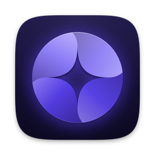
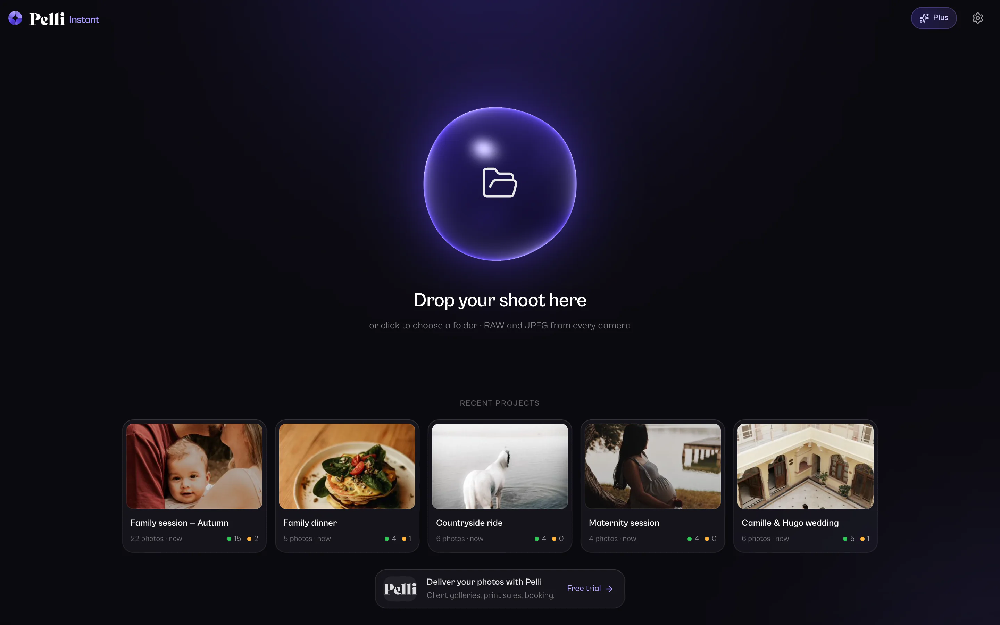
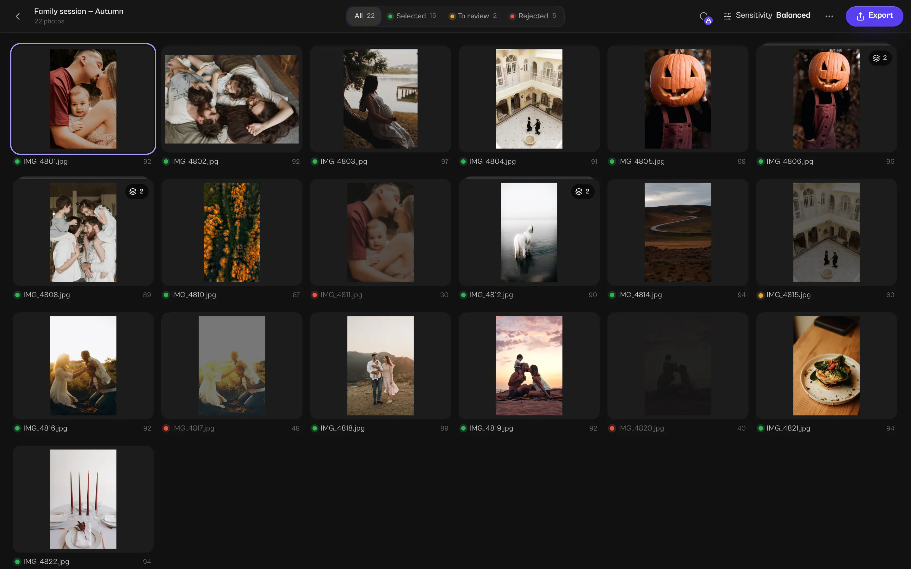
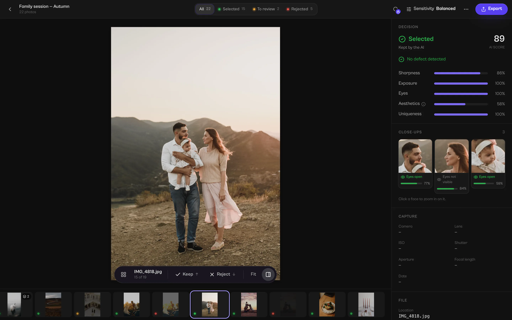
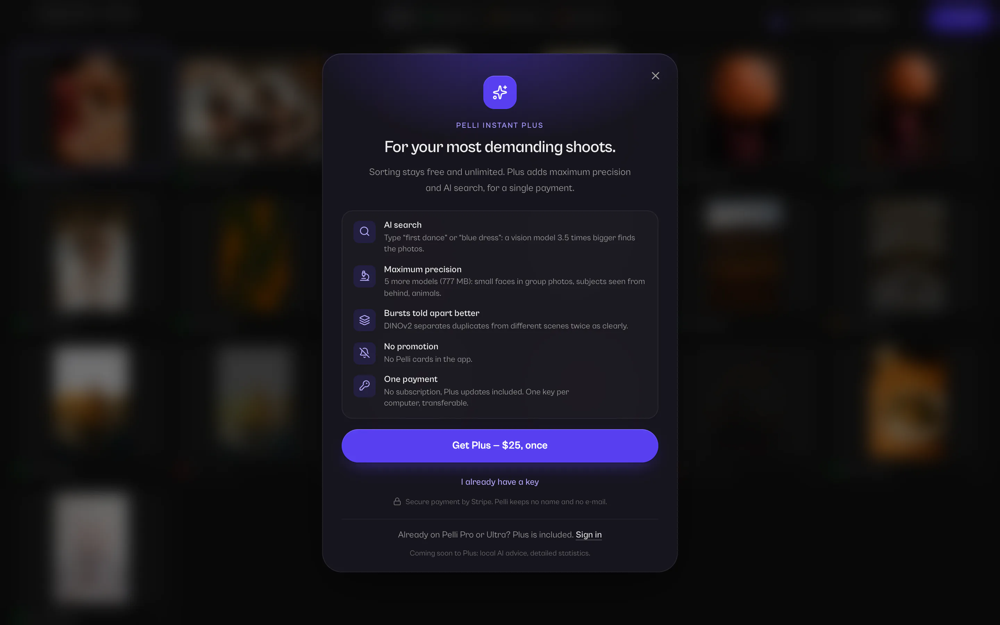
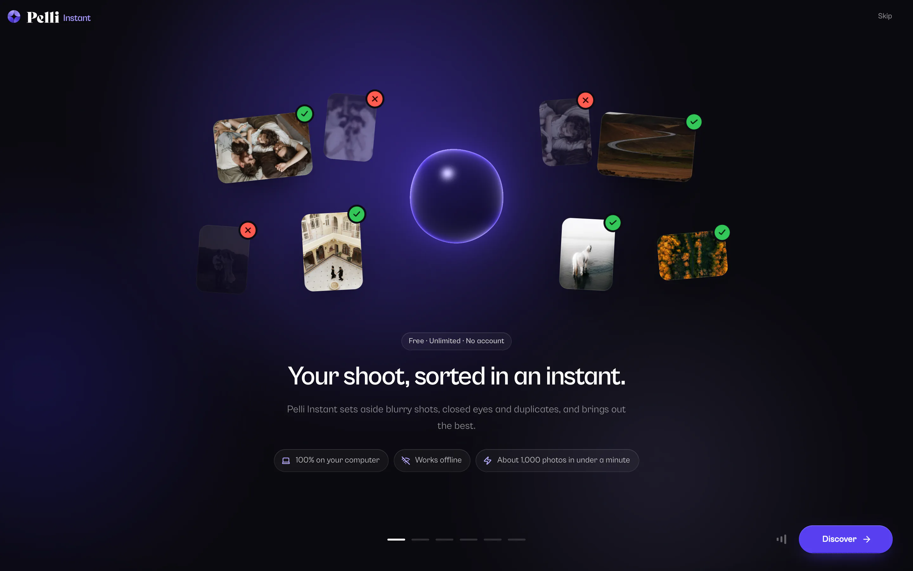

<div align="center">

<a href="https://pelli.io"></a>

# Pelli Instant

**Free AI photo culling for Mac and Windows. Unlimited, no account, 100 % on your computer.**<br />
Drop a shoot: blurry shots, closed eyes and duplicates are set aside, the best photos are kept. About 1,000 photos in under a minute.

[](#pelli-instant-plus)
[](#privacy-and-telemetry)
[](#privacy-and-telemetry)
[](https://github.com/Synapsr/Pelli-Instant/releases)
[](https://github.com/Synapsr/Pelli-Instant/actions/workflows/ci.yml)
[](LICENSE)
[](#install)
[](https://tauri.app)
[](docs/contributing.md)

[**Website**](https://pelli.io) · [**Download**](https://github.com/Synapsr/Pelli-Instant/releases) · [**Docs**](docs/) · [**Contributing**](docs/contributing.md) · [Français](README.fr.md)

</div>

<p align="center">
  
</p>

## What is Pelli Instant?

Pelli Instant sorts a photo shoot for you. Drop a folder of RAW or JPEG files: it flags blurry and shaken photos, closed eyes, bad exposure and duplicates, keeps the best shot of each burst, and splits the shoot into **Selected**, **To review** and **Rejected**. You go through its choices with the keyboard, change what you disagree with, and export: star ratings and colour labels for Lightroom, Capture One or Bridge, a copy of your selection, or the rejects filed away in a sub-folder.

- **Free and unlimited.** Sort as many shoots as you like, at the Standard precision, with nothing to pay and no monthly limit.
- **No account.** Download, open, drop a folder. Nothing to sign up for.
- **100 % local.** The AI models run on your computer with ONNX Runtime, on the processor of Apple Silicon Macs (the fastest there) and accelerated by DirectML on Windows. Your photos never leave your computer, and sorting works offline.
- **Fast.** Dozens of photos a second: a beta tester sorted 854 photos in about 10 seconds.

Pelli Instant is made by the team behind [Pelli](https://pelli.io), the platform where photographers deliver and sell their work. The app is open source under the MIT licence. An optional, one-time [Pelli Instant Plus](#pelli-instant-plus) adds maximum precision and AI search.

Looking for an open-source alternative to Aftershoot, Narrative Select or FilterPixel, one that keeps your photos on your computer? That's what Pelli Instant is for.

## How it works

1. **Drop a shoot.** Drag a folder onto the window, or choose one, with or without its sub-folders. A RAW and its JPEG twin count as one photo.
2. **Let it sort.** Before the first analysis, Pelli Instant shows what it will check; turn off what you don't want, or just start. It reads the preview your camera embedded in each RAW (it never develops the RAW), measures focus, motion blur and exposure, finds faces and closed eyes, and groups bursts. The grid fills in as it goes.
3. **Review.** Selected, To review, Rejected: each rejection says why (Blurry, Motion blur, Eyes closed, Duplicate…). Fix any call in one key. Your own choices always win over the AI's.
4. **Export.** Ratings for Lightroom, a copy of the selection, or the rejects moved aside. Nothing is ever deleted.

<p align="center">
  
  <br />
  <sub>Photos: Pexels (<a href="docs/images/CREDITS.md">credits</a>). The verdicts are the app's own.</sub>
</p>

## Features

| Feature | What it does |
| --- | --- |
| **Free, unlimited, no account** | Every analysis runs on your computer: no quota, no sign-in, no internet needed. |
| **Focus you can trust** | Measures how wide the edges are, not how contrasted: shallow depth of field, high ISO and soft light are not mistaken for blur. When there is a face, its focus comes first: a sharp face on creamy bokeh is sharp, a sharp background behind a soft face is *Subject out of focus*. |
| **Motion blur** | Tells camera shake and moving subjects from oriented textures such as hair, fur or fabric. |
| **Closed eyes** | Reads the eyes of the faces in the photo, and tells a blink from a smile that narrows the eyes. On Balanced and Lenient, closed eyes send a photo to review, never to the rejects on their own: a kiss or a prayer closes them on purpose. |
| **Exposure in stops** | Estimates how many stops a photo is off. Low-key and high-key photos made on purpose stay fine; 2 stops off usually goes to review, since a RAW can recover it. |
| **Bursts and duplicates** | Groups similar shots taken seconds apart by the same camera and keeps the best one, or the best few. Exact copies are found whatever their date. |
| **Three sensitivities** | Strict, Balanced or Lenient. Switching re-sorts the shoot instantly, without analysing it again. |
| **Your criteria** | Before the first analysis of a shoot, turn each check on or off: blur, motion blur, subject focus, closed eyes, under- and overexposure, similar shots, exact copies. *Respect artistic blur* is there for bokeh and blur on purpose. Each shoot keeps its own criteria; the defaults are in *Settings → Analysis*. |
| **Standard precision, free** | The models that come with the app: fast, and already very fine. *Maximum*, with bigger models, is part of [Plus](#pelli-instant-plus). |
| **Review at the keyboard** | Grid, loupe with zoom at 100 %, and side-by-side compare of a burst. All photos or one decision at a time, filtered by reason (Blurry, Eyes closed…). In the loupe, ↑ keeps and ↓ rejects, ⌥← / ⌥→ step through a burst; the Lightroom keys P, X and U work everywhere. |
| **AI search** (Plus) | Type "bride bouquet" or "first dance" and the matching photos come first. Common wedding, event and portrait words, colours and clothing ("robe bleue", "haut rouge") also work in French, Spanish, German and Italian. |
| **Ratings for Lightroom** | Writes stars, colour labels and Pick/Reject flags to an `.xmp` file next to each RAW, for Lightroom, Capture One, Bridge or darktable. You choose the stars and colour of each decision in the export (Selected ★★★ green, To review yellow, Rejected by default), and the colour names are written in your Lightroom's language. Selected photos arrive flagged *Picked* and rejects *Rejected* in Lightroom Classic 13.2 and later. Stars you gave in the camera count as yours, an existing `.xmp` keeps all its settings, and stars, labels and flags from another app stay unless you change them in Pelli Instant. |
| **Copy the selection** | RAW, JPEG or both, to the folder of your choice, sub-folders kept. Pelli Instant tells you how much disk space the copy needs. Each file is copied whole or not at all, and exporting again doesn't copy a photo twice. |
| **Rejects filed away** | Moves the rejects to a `_Rejets Pelli` sub-folder next to the originals: a RAW, its JPEG and its `.xmp` move together. Nothing is deleted. |
| **Gives way to your other apps** | A switch in *Settings → General* runs the analysis in the background, on fewer cores at a low priority: Lightroom and your browser stay smooth, sorting takes 3 to 5 times longer. Off by default, for the fastest sort. |
| **Works while you're away** | An analysis, an export or the Maximum download keeps the computer from going to sleep, and on a Mac keeps full speed with the window hidden. The screen can still turn off. |
| **Most cameras** | Canon CR2 and CR3, Nikon NEF, Sony ARW, Fujifilm RAF, DNG, Olympus and OM System ORF, Panasonic RW2, Pentax PEF, Samsung SRW, plus JPEG, PNG and TIFF. |
| **Picks up where you left off** | Your projects stay on the home screen. Opening a folder again only analyses new or changed photos. |
| **A guided start** | A short tour on first launch, with a voice-over you can mute: how it judges a photo, the keys, the exports, the precision, and whether to share anonymous statistics. Replay it from *Settings → About*. |
| **Made for judging photos** | A dark, neutral interface, like Lightroom, so you judge colours on a neutral surround. In 9 languages. |

### Keyboard

| Key | Action |
| --- | --- |
| <kbd>←</kbd> <kbd>→</kbd> | Previous / next photo |
| <kbd>⌥</kbd> <kbd>←</kbd> <kbd>→</kbd> | Previous / next photo of the burst |
| <kbd>↑</kbd> / <kbd>↓</kbd> (loupe) | Keep / reject |
| <kbd>P</kbd> / <kbd>X</kbd> / <kbd>U</kbd> | Keep / reject / remove the flag, everywhere |
| <kbd>1</kbd>–<kbd>5</kbd> | Stars |
| <kbd>6</kbd>–<kbd>9</kbd> | Red, yellow, green, blue label |
| <kbd>Space</kbd> | Loupe |
| <kbd>C</kbd> | Compare |
| <kbd>Z</kbd> | Zoom 100 % |
| <kbd>⌘</kbd> <kbd>F</kbd> | AI search (Plus) |
| <kbd>⌘</kbd> <kbd>E</kbd> | Export |
| <kbd>?</kbd> | All shortcuts |

On Windows, <kbd>Ctrl</kbd> replaces <kbd>⌘</kbd>.

<p align="center">
  
</p>

## Pelli Instant Plus

Sorting stays free and unlimited. **Plus** is for your most demanding shoots: **25 € in Europe, $25 elsewhere, paid once**, for one computer. No subscription, no account, Plus updates included.

| With Plus | What it brings |
| --- | --- |
| **Maximum precision** | 5 more models, about 777 MB, downloaded once: RetinaFace ResNet-50 finds the small faces of group photos (a second pass at 1280 px), DINOv2 groups bursts and near-duplicates (it separates duplicates from different scenes about twice as clearly as Standard's CLIP B/32: +0.25 of cosine against +0.11), CLIP ViT-L/14 (a vision model about 3.5 times bigger) for search and the aesthetic score, RF-DETR-Seg judges subjects without a usable face (seen from behind, animals), with the LAION V2 aesthetic head. Slower, finer. |
| **AI search** | Type "first dance", "blue dress" or "robe bleue": the matching photos come first. |
| **No Pelli promotion** | The free version shows two small Pelli cards, on the home screen and at the end of an export. Plus removes them. |

- **One key per computer, transferable.** Payment goes through Stripe in your browser, and the app activates by itself. Your key (`XXXX-XXXX-XXXX-XXXX`) is shown in the app and on the confirmation page: to move Plus to another computer, *Release this licence* in *Settings → Pelli Instant Plus*, then enter the key on the other one. Reinstalling on the same computer just needs the key again.
- **Private.** Pelli keeps no name, no e-mail and no country for Plus: only the key, a hash of your computer's id and the payment's reference. Stripe handles the payment and sends the receipt, as for every Pelli payment. Once activated, Plus works offline.
- **Already on Pelli Pro or Ultra?** Plus is included (lifetime deals and Pro or Ultra trials too): sign in with your Pelli account in *Settings → Pelli Instant Plus*.

<p align="center">
  
</p>

### Coming soon

- **Local AI advice**, in Plus: an optional model, on your computer too, that comments each photo or a whole shoot.
- **Detailed statistics**, in Plus: your keep rate, the reasons for rejects and more, across all your shoots.

<p align="center">
  
</p>

## Install

### Download

| Platform | Latest version |
| --- | --- |
| macOS 12 or later, Apple Silicon (M1 or newer) | [PelliInstant-macos-arm64.dmg](https://github.com/Synapsr/Pelli-Instant/releases/latest/download/PelliInstant-macos-arm64.dmg)|
| Windows 10 and 11 (x64) | [PelliInstant-windows-x64-setup.exe](https://github.com/Synapsr/Pelli-Instant/releases/latest/download/PelliInstant-windows-x64-setup.exe) |

The Standard models come inside the installer, so Pelli Instant works as soon as it is installed, offline included; the Maximum pack is downloaded from the app, with Plus, only if you choose it. Each download has its SHA-256 fingerprint next to it (`.sha256`), and every release built by the [release workflow](.github/workflows/release.yml) comes with a `SHA256SUMS` file and a [build attestation](https://docs.github.com/actions/security-for-github-actions/using-artifact-attestations) you can check with `gh attestation verify <file> --repo Synapsr/Pelli-Instant`.

<details>
<summary><b>Intel Macs</b></summary>

There is no build for Intel Macs: ONNX Runtime, which runs the AI models, ships no prebuilt library for them. Building ONNX Runtime yourself is possible; see [`crates/cull-ml/README.md`](crates/cull-ml/README.md#packaging-onnx-runtime-tauri).

</details>

<details>
<summary><b>Windows SmartScreen warning</b></summary>

The Windows installer isn't signed with a code-signing certificate yet, so SmartScreen may warn about an unknown publisher. Click **More info → Run anyway**. You can check the installer against its `.sha256` first. It installs for your user only and doesn't ask for administrator rights. Its updates are signed with Pelli Instant's update key, which the app checks before installing them.

</details>

<details>
<summary><b>Linux</b></summary>

There is no Linux build. The engine compiles and its tests run on Linux in CI, and `pnpm tauri dev` may start, but the app is neither packaged nor tested there. On Linux, the token of the optional Pelli account would be kept in the app's local database rather than in a system keychain.

</details>

<details>
<summary><b>macOS folder access</b></summary>

If macOS refuses access to a folder (Desktop, Documents, an external drive), allow Pelli Instant in **System Settings → Privacy & Security → Files and Folders**, then open the folder again.

</details>

### Updates

Pelli Instant updates itself. A few seconds after launch, then every six hours, it checks the [latest release](https://github.com/Synapsr/Pelli-Instant/releases/latest); when there is a newer version, the window offers it. Install it in one click: the update is downloaded, its signature is checked against Pelli Instant's own key, and the app restarts on the new version once no analysis, export or download is under way. *Settings → About* checks by hand. Prereleases are never offered.

### Build from source

Requires [rustup](https://rustup.rs) (it installs the Rust version pinned in `rust-toolchain.toml`), [Node.js](https://nodejs.org) 22 and [pnpm](https://pnpm.io) 10, on an Apple Silicon Mac or a Windows x64 PC.

```sh
git clone https://github.com/Synapsr/Pelli-Instant.git
cd Pelli-Instant
pnpm install
pnpm models         # download the Standard models once (about 223 MB, SHA-256 checked)
pnpm tauri dev      # run the app in development
```

Built from source, it sorts exactly like the official app: free, unlimited, no account. To work on the interface alone, run `pnpm dev` and open <http://localhost:1420>: a simulated engine in the browser, no Rust build needed. Building an installer with the models inside, a fake Pelli to work on Plus and telemetry, and everything else, is in [docs/contributing.md](docs/contributing.md).

## Privacy and telemetry

- **Your photos are sorted on your computer.** Pelli Instant reads them where they are; sorting never sends them anywhere, not even their file names. Its measures, decisions and your marks are kept in a local database, its previews in a cache folder, both in your user account ([where](docs/architecture.md#where-data-lives)).
- **Your folders stay untouched until you export.** Exporting writes `.xmp` files next to your RAWs, copies the selection where you say, or moves the rejects to `_Rejets Pelli`. Your photo files are never modified or deleted.
- **No account, no sign-in.** Nothing to create, nothing to log in to.

### Anonymous statistics

Pelli Instant sends a few anonymous statistics to Pelli (`app.pelli.io`), so we know how many people use it and how fast it sorts. **It is on by default and one switch turns it off:** in the last step of the welcome tour (with the details of what is sent), or later in *Settings → Privacy*. The code is in [`crates/cull-engine/src/telemetry.rs`](crates/cull-engine/src/telemetry.rs).

| Event | When | What it says |
| --- | --- | --- |
| `onboarding_completed` | The welcome tour is finished | Nothing more |
| `app_opened` | At start, at most once a day | Nothing more |
| `analysis_completed` | A sort ended | The number of photos (RAW, JPEG), the duration, the precision, how many were selected, to review and rejected, the number of bursts |
| `export_completed` | An export finished | The number of photos and the outputs chosen (ratings, copy, rejects moved) |
| `plus_activated` | Plus was activated | How: purchase, key or Pelli account |
| `telemetry_disabled` | You turned the statistics off | Nothing more: it is the last message |

Every message also carries a random install id (a random number, not tied to your computer, a licence or an account), the app version, the system (Mac, Windows), the processor type (arm64, x64) and the app language. Never a photo, a file name, a folder, your name or anything personal. Pelli stores no IP address with them.

- **Turned off during the welcome tour, nothing is ever sent.**
- **Turned off later**, the app sends one last `telemetry_disabled`, then nothing, and deletes the install id. Turning it on again creates a new one.
- Each message is sent in the background (5 s at most, no retry, nothing kept on disk): statistics never slow down or block anything.

### What else talks to the internet

- **Pelli Instant Plus, if you use it.** Showing the price asks Pelli for it (Pelli reads your country from the connection to choose euros or dollars, and doesn't keep it). Buying sends a hash of your computer's id, the language, the system and the app version, then waits for the payment. Activating a key sends the key and that hash. At most once a day when online, the app checks the licence is still valid; the Maximum pack is downloaded from links Pelli hands out after checking the licence, and each file is checked against its SHA-256.
- **The optional Pelli account**, only if you sign in to get Plus with a Pro or Ultra plan: Pelli receives your computer's name, shown on the consent page in your browser; the token is then kept in the macOS Keychain or the Windows Credential Manager. Signing out deletes it.
- **Updates**: the app reads `latest.json` from the latest release on GitHub, and downloads an update only when you install it.
- Requests to Pelli carry the app version, the system and the interface language. **No crash reporter.** ONNX Runtime's own telemetry is switched off.
- **The AI models** are fixed files at pinned versions, and their SHA-256 fingerprints are checked when they load. Built from source, `pnpm models` downloads the Standard ones once from Hugging Face and the other sources listed in [`models/manifest.json`](models/manifest.json).
- **Removing a project** from the home screen deletes its previews and analysis, never your photos. **Deleting the Maximum pack** (*Settings → Analysis*) frees its 777 MB.

## Languages

**Interface:** English, French, Spanish, German, Italian, Portuguese, Dutch, Polish and Swedish, with the welcome tour narrated in each of them. [Add yours](docs/contributing.md#conventions).

**AI search:** the model understands English. A built-in glossary translates common wedding, event and portrait words, colours, clothing and places from French, Spanish, German and Italian; other words pass through as typed.

## FAQ

<details>
<summary><b>Is Pelli Instant free?</b></summary>

Yes, and without limits: sort as many photos as you like, at the Standard precision, without an account. The app is open source under the MIT licence. [Plus](#pelli-instant-plus) is optional: 25 € in Europe or $25 elsewhere, once, for maximum precision, AI search and no Pelli cards.

</details>

<details>
<summary><b>Standard or Maximum precision?</b></summary>

Standard comes with the app, is fast, and suits most shoots. Maximum, part of Plus, adds bigger models, about 777 MB to download once: a second face detector for group photos, a model that tells bursts and near-duplicates apart from different scenes more clearly, a bigger CLIP model for search and the aesthetic score, and the outline of people and animals, so a subject without a visible face (seen from behind, back-lit) is judged on its own focus and exposure. The analysis is slower and needs more memory.

With Plus, choose it in *Settings → Analysis → Precision* (or in the welcome tour): the download starts in the background, resumes where it stopped if you pause it or quit, and every file is checked before use. Until it is ready, analyses run in Standard. A shoot already sorted can be analysed again in Maximum.

</details>

<details>
<summary><b>How do I move Plus to another computer?</b></summary>

On the old computer, *Settings → Pelli Instant Plus → Release this licence* (copy your key first). On the new one, open the Plus window, choose *I already have a key* and type it. One key works on one computer at a time. If the old computer is gone, write to [contact@pelli.io](mailto:contact@pelli.io).

</details>

<details>
<summary><b>Does it work offline?</b></summary>

Yes. Sorting, reviewing and exporting run entirely on your computer, without the internet. Plus works offline once activated. Buying or activating Plus, downloading the Maximum pack and updates need a connection.

</details>

<details>
<summary><b>Does Pelli Instant collect data?</b></summary>

Only anonymous statistics, which you can turn off: how many photos you sort, how long it takes, the app version. Never your photos or their names. The full list is in [Privacy and telemetry](#privacy-and-telemetry); declining during the welcome tour sends nothing at all.

</details>

<details>
<summary><b>Does it change my RAW files?</b></summary>

No. Stars, colour labels and flags go into an `.xmp` sidecar next to each RAW (`IMG_0001.xmp`, or `IMG_0001.CR3.xmp` when that one already exists), and every other setting in an existing sidecar is kept: develop settings, keywords, history. Stars, labels and flags you set in Lightroom or Capture One stay too, unless you set them in Pelli Instant: the values that come from the AI's decisions only replace the ones Pelli Instant wrote itself. Stars you gave in the camera become your own stars in Pelli Instant (unless the RAW already has a sidecar), so the export keeps them.

Lightroom Classic reads the sidecar of a photo when it imports it. For photos already in the catalogue, select them, then **Metadata → Read Metadata from Files**: *Synchronize Folder* imports the new photos but doesn't read the sidecars of the others again. Selected photos come in flagged *Picked* and rejected ones *Rejected*: Lightroom Classic reads its flags from the sidecar since version 13.2 (February 2024). Bridge has no flags; with the default ratings it shows a rejected photo's −1 star as *Reject*. JPEG-only shoots get no sidecar, since Lightroom reads a JPEG's ratings inside the file.

</details>

<details>
<summary><b>Why are my colour labels white in Lightroom?</b></summary>

Lightroom Classic shows a colour label only when its name matches its Color Label Set, whose names follow Lightroom's language: a French Lightroom expects *Rouge*, *Jaune*, *Vert*, *Bleu*, *Violet*, and shows *Red* as a white custom label. In the export, *Colour names* writes the names of your Lightroom's language (the app's language until you pick another); Lightroom lists its own under **Metadata → Color Label Set → Edit**. Export again, then **Metadata → Read Metadata from Files**: the labels Pelli Instant wrote are replaced by the new names, the ones you set yourself stay. Capture One reads English names, or those of its own language.

</details>

<details>
<summary><b>What happens to my files when I copy the selection or file away the rejects?</b></summary>

Copies go through a hidden temporary file, renamed once complete: a full disk or an unplugged drive never leaves a half-copied photo. A file already copied by an earlier export is left as it is, and when a name is taken by another file, the photo gets one suffix for all its files (`IMG_0001-1.CR3`, `IMG_0001-1.JPG`, `IMG_0001-1.xmp`).

Rejects move with their JPEG twin and their sidecar, all together or not at all: if one file can't move, the others go back. Across disks, a file is copied and checked before the original is removed.

The folders an export fills (the rejects folder, a new or empty copy folder) get a small hidden file, `.pelli-instant-export`, so that a copy made inside the shoot is never analysed again as new photos. Delete that file to analyse them.

</details>

<details>
<summary><b>Which cameras are supported?</b></summary>

Pelli Instant reads the JPEG preview that the camera embeds in each RAW: Canon CR2 and CR3, Nikon NEF and NRW, Sony ARW, SR2 and SRF, Fujifilm RAF, DNG, Olympus and OM System ORF, Panasonic RW2, Pentax PEF, Samsung SRW, and other TIFF-based RAWs, plus JPEG, PNG and TIFF files. Not supported: HEIF/HEIC, and the CR3 files of recent Canon bodies shot in HDR PQ mode, whose previews are HEVC. The full list, with the cameras tested, is in [`crates/cull-decode/README.md`](crates/cull-decode/README.md).

</details>

<details>
<summary><b>How does it decide?</b></summary>

Every photo gets a score from 0 to 100, which mixes focus, an aesthetic score made relative to your shoot, eyes, exposure and uniqueness. A clear technical problem rejects a photo; a mild one sends it to review. The thresholds are relative to your shoot as well as absolute, so a dim reception at high ISO is not mass-rejected. The details, written for photographers, are in [`crates/cull-analysis/README.md`](crates/cull-analysis/README.md#for-photographers).

</details>

<details>
<summary><b>Are my photos used to train AI models?</b></summary>

No. Sorting runs on your computer and never sends your photos, so neither Pelli nor anyone else receives them to train anything. The models are fixed files; they don't learn from your shoots.

</details>

<details>
<summary><b>Why no Intel Mac or Linux version?</b></summary>

Intel Macs: ONNX Runtime has no prebuilt library for them. Linux: the app isn't packaged or tested there yet. Both are open to contributions.

</details>

## Contributing

Bug reports, translations and pull requests are welcome. Start with [docs/contributing.md](docs/contributing.md) (setup, checks, conventions), then read the [architecture](docs/architecture.md) and the [models](docs/models.md). Pelli Instant aims to stay quick and trustworthy: every rejection gives its reason, and before adding a setting, ask whether a better default would do.

- [Report a bug](https://github.com/Synapsr/Pelli-Instant/issues/new?template=bug_report.yml)
- [Suggest an improvement](https://github.com/Synapsr/Pelli-Instant/issues/new?template=feature_request.yml)
- Found a security issue? See [SECURITY.md](SECURITY.md).
- Anything else: [contact@pelli.io](mailto:contact@pelli.io)

If Pelli Instant saves you an evening of culling, a star helps other photographers find it.

## Credits

Pelli Instant runs [YuNet](https://github.com/opencv/opencv_zoo) (OpenCV Zoo) to find faces, [MediaPipe Face Mesh and Face Blendshapes](https://github.com/google-ai-edge/mediapipe) (Google; Face Mesh converted to ONNX by [PINTO0309](https://github.com/PINTO0309/PINTO_model_zoo)) to read eyes and expressions, [CLIP](https://github.com/openai/CLIP) (OpenAI, ONNX by [Xenova](https://huggingface.co/Xenova)) for similar shots and search, and the [LAION aesthetic predictor](https://github.com/LAION-AI/aesthetic-predictor). Maximum precision adds CLIP ViT-L/14, [DINOv2](https://github.com/facebookresearch/dinov2) (Meta, ONNX by [onnx-community](https://huggingface.co/onnx-community/dinov2-base-ONNX)), [RF-DETR](https://github.com/roboflow/rf-detr) (Roboflow), [RetinaFace](https://github.com/biubug6/Pytorch_Retinaface) (biubug6) and the [improved aesthetic predictor](https://github.com/christophschuhmann/improved-aesthetic-predictor) (Christoph Schuhmann). All run through [ONNX Runtime](https://onnxruntime.ai) and [`ort`](https://ort.pyke.io). The app is built with [Tauri](https://tauri.app), React and [HeroUI](https://heroui.com). The welcome tour's photos and voice-over are credited in [`src/assets/onboarding/CREDITS.md`](src/assets/onboarding/CREDITS.md). See [THIRD_PARTY_NOTICES.md](THIRD_PARTY_NOTICES.md).

## License

[MIT](LICENSE) © Synapsr
